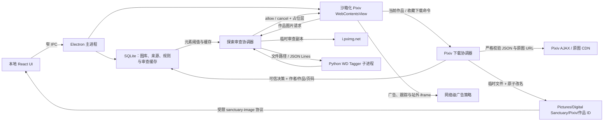

# 纯净领域架构与演进计划

- 文档状态：当前架构基线 + 后续演进计划
- 基线日期：2026-08-11
- 最近同步：探索审查闭环、可信 Pixiv 下载、本地画廊与作者两级浏览阶段已完成
- 面向读者：接手实现的开发者或代码模型

## 1. 产品边界

纯净领域是本地优先的 Pixiv 安全浏览与二次元图片管理桌面应用。它过滤的是用户明确不欢迎的**画面元素**，不是年龄分级。

必须保持的产品语义：

- 正常 R18、裸体、色情或擦边内容不是默认拦截目标。
- 猎奇、血腥、断肢和当前模型可覆盖的排泄相关元素才进入黑名单规则。
- 未知、下载失败、模型失败或超时必须失败闭合，不能先显示原图。
- 广告过滤与内容过滤是两条独立管线：广告看页面/网络语义，内容过滤看图片本身。
- 失败闭合只约束远程探索展示和明确要求模型分析的任务；用户主动保存的 Pixiv 作品属于可信输入，不自动运行模型，也不继承旧的模糊/隐藏判定。
- 不在 Electron 内嵌页运行第三方 OAuth，不伪装浏览器指纹，不读取账号凭据或复制系统浏览器 Cookie。

## 2. 当前运行架构



### 2.1 本地 UI

- `apps/desktop/src/renderer/src/App.tsx`：画廊、规则和探索三种视图，以及下载进度、作者浏览和大图查看交互。
- `apps/desktop/src/renderer/src/styles.css`：默认浅色设计，白色导航、浅灰内容区、Pixiv 蓝交互色。
- 探索模式保留精简应用侧栏，远程 Pixiv 页面填满其余内容区；应用按钮和网页内下载按钮最终都只向主进程发送受限命令。
- 画廊直接使用原图并进行视口懒加载，不生成降质缩略图。它支持平铺和“作者封面墙 → 作者作品页”两级浏览；点击图片进入可翻页、可按 `Esc` 关闭的大图层。

### 2.2 Electron 主进程

- `apps/desktop/src/main/index.ts`：当前仍是组合根，负责窗口、IPC、Pixiv 视图、网络拦截、远程图片审查、下载协调和视觉进程生命周期。
- 主进程启动时申请 Electron 单实例锁；重复启动只唤醒现有窗口，不创建第二个 Pixiv session/view。
- `apps/desktop/src/main/explore-policy.ts`：可单元测试的 URL、权限、广告和资源策略。
- `apps/desktop/src/main/pixiv-dom-adapter.ts`：幂等注入拦截占位层、“仅本次查看”和作品页下载按钮。宽泛的第一方 PR/BOOTH DOM 猜测已经移除，避免再次误伤普通作品。
- `apps/desktop/src/shared/pixiv-download.ts`：Pixiv 页面上下文、AJAX 响应和原图 URL 的纯函数校验。
- `apps/desktop/src/shared/bounded-concurrency.ts`：下载任务使用的通用并发门；当前原图和收藏作品任务上限均为 4。
- `apps/desktop/src/main/explore-review-queue.ts` 与 `apps/desktop/src/preload/explore.ts`：视口优先审查实验。因 KI-0004 默认关闭，当前生产路径仍在网络回调中串行审查。
- `apps/desktop/src/main/vision-client.ts`：版本化 JSON Lines 客户端、超时和子进程错误处理。
- Pixiv 使用 `persist:pixiv` 独立持久化 session；本地 React 渲染器不能访问其 DOM 或 Cookie。单实例锁避免多个进程造成“登录一次却看似丢失会话”的错觉。

### 2.3 视觉与领域层

- `services/vision/python/`：WD SwinV2 Tagger v3 推理实现。
- `packages/domain/`：元素组、阈值、标签映射和 `allow / blur / hide` 决策。
- `packages/protocol/`：桌面端与视觉子进程之间的协议。
- `packages/database/`：本地图库、分类、Pixiv 作者/作品来源、元素规则设置和远程审查缓存。
- 开发环境检测到 `.venv-gpu` 时优先请求 CUDA，初始化失败回退 CPU。RTX 4050 基准中单图中位数约由 463 ms 降至 72 ms；provider 选择不改变模型版本和缓存语义。

## 3. 当前探索请求流

1. Pixiv 请求普通界面图片、头像或登录素材：直接放行。
2. 请求命中广告/追踪域名：网络层取消，并增加“广告拦截”计数。
3. 请求是非 Pixiv 第三方 iframe：默认取消；`accounts.pixiv.net` 登录页所需的 reCAPTCHA 是窄例外。
4. 请求是视频：当前失败闭合并取消。
5. 请求是 `i.pximg.net` 的 `img-master`、`img-original` 或 `custom-thumb` 作品图：
   - 相同 URL 在进程内去重；
   - 先按规范化 URL、引擎、引擎版本和规则指纹查询持久化缓存；
   - 缓存命中完整结果时直接决定 allow/block，不下载或重复推理；
   - 带 Pixiv `Referer` 下载不超过 12 MiB 的临时副本；
   - 串行交给 WD Tagger，避免并发请求的超时从排队阶段开始累计；
   - 使用数据库中的当前元素规则判定；
   - `allow` 后恢复原始网络请求；其他结果取消原始请求并注入本地占位层；
   - 占位层显示命中原因；用户点击“仅本次查看”后通过受限消息通道请求单 URL 单次放行，不写入永久 `allow` 缓存；
   - 推理后删除临时文件。

当前未命中缓存时仍会为审查下载一次图片、放行后由页面再下载一次。它是安全的最小闭环，但不是最终的网络效率形态。

### 3.1 当前 Pixiv 下载与画廊流

1. 只有作品详情页允许“保存当前作品”；只有收藏作品页允许“下载全部收藏”。网页内按钮携带的作品 ID 必须与当前顶层 URL 一致。
2. 主进程通过登录 session 获取作品页清单、作者信息和公开/非公开收藏 ID；所有 JSON 响应和 `i.pximg.net` 原图 URL 都经过严格校验。
3. 原图请求绕开探索页内容拦截器，使用 Pixiv 作品页 `Referer`、流式临时文件和原子改名；全局网络并发上限为 4。
4. 文件保存在用户“图片/Digital Sanctuary/Pixiv/作品 ID”中；已有文件跳过网络下载，但仍补齐数据库索引与来源元数据。
5. 所有用户主动下载都调用 `trustArtwork`：清除旧模型结果并保存明确的 `allow` 决策，不自动运行 WD Tagger。
6. SQLite 保存 `workId`、`pageIndex`、`authorId`、`authorName` 和标题；画廊据此聚合同一作品的多页和同一作者的作品。
7. 本地图片仅通过 `sanctuary-image` 自定义协议返回，并且只有数据库已索引、文件仍存在的路径可以读取。

## 4. 安全不变量

- `contextIsolation: true`、`nodeIntegration: false`、`sandbox: true`、`webSecurity: true`。
- 顶层导航只允许 HTTPS `pixiv.net` 及子域。
- 弹窗、下载和权限默认拒绝；例外必须是可测试的窄规则。
- 远程 Pixiv 页面不获得本地文件、数据库、视觉进程或通用 IPC 权限。
- 系统浏览器入口只能打开代码中固定的 Pixiv 官方密码设置 URL。
- 过滤规则变化后必须使旧的远程审查缓存失效。
- 任何缓存键必须包含模型/引擎版本和规则指纹，不能把旧模型的 `allow` 永久复用。
- 被拦截图片必须先取消原请求再显示占位层；一次性查看必须是明确的单张图片操作，且不能改变持久化缓存。
- 远程 Pixiv 页面不能直接指定下载目标路径；所有作品 ID、原图域名、扩展名、文件上限和落盘目录由主进程重新验证或生成。
- “用户信任”和“模型分析”是不同概念。未来的图库整理模型只能写标签或建议，未经用户确认不能把主动下载作品改为模糊/隐藏。

## 5. 广告过滤分层

广告过滤不能与元素黑名单混为一谈：

1. **网络级过滤（已实现并保留）**：拦截已知广告/追踪域名和站外 iframe，降低请求数与渲染进程数。
2. **Pixiv 第一方美容过滤（冻结）**：旧的 DOM 祖先猜测曾引发 KI-0003，把普通作品列表整块隐藏，现已移除。第一方 PR/BOOTH 卡片可能继续出现，当前优先使用 Pixiv Premium 官方广告开关；若以后恢复，必须采用标准规则引擎或有夹具覆盖的精确适配器。

第一方广告与普通作品共用 Pixiv 域名和图片 CDN，不能封禁整个 `pixiv.net`/`pximg.net`，也不能把广告插画当作不欢迎元素送入 WD Tagger。

## 6. 目标模块拆分

在继续扩大功能前，将 `apps/desktop/src/main/index.ts` 中的探索逻辑逐步迁移为：

```text
apps/desktop/src/main/explore/
  controller.ts              # WebContentsView 生命周期与状态汇总
  navigation-policy.ts       # 顶层导航、弹窗、权限和下载
  adblock-policy.ts          # 广告域名和站外 iframe 策略
  pixiv-url-adapter.ts       # 作品 CDN URL 识别与规范化
  pixiv-dom-adapter.ts       # 第一方 PR 卡片、占位层和页面结构探针
  review-coordinator.ts      # 去重、排队、下载、判定和统计
  review-cache.ts            # SQLite 持久化审查缓存
  types.ts                   # ExploreState 等共享主进程类型

apps/desktop/src/main/download/
  controller.ts              # 单作品与收藏任务、进度和取消边界
  pixiv-api.ts               # 登录 session 下的 Pixiv AJAX 访问
  original-fetch.ts          # 原图流式下载、限流、临时文件与原子改名

apps/desktop/src/main/library/
  controller.ts              # 导入、可信下载入库与显式模型整理入口
```

迁移必须小步进行：先复制测试覆盖，再移动代码，不要一次性重写 `index.ts`。

## 7. 持久化审查缓存计划

SQLite 已增加并使用 `remote_image_reviews`：

```sql
CREATE TABLE remote_image_reviews (
  normalized_url TEXT NOT NULL,
  content_hash TEXT,
  engine TEXT NOT NULL,
  engine_version TEXT NOT NULL,
  rules_fingerprint TEXT NOT NULL,
  assessment_json TEXT NOT NULL,
  decision_json TEXT NOT NULL,
  byte_length INTEGER NOT NULL,
  reviewed_at TEXT NOT NULL,
  PRIMARY KEY (normalized_url, engine, engine_version, rules_fingerprint)
);
```

实施要求：

- 只缓存完整、可解析的审查结果；网络错误和模型错误不应成为永久记录。
- 规则指纹由启用状态、标签、阈值和动作的稳定序列计算。
- 模型或标签表版本变化时不能复用旧结果。
- 设定容量/时间清理策略；不要永久保存远程图片文件。
- 若未来用内容哈希跨 URL 复用，仍要验证响应内容，不能只相信 URL 参数。
- 当前默认在应用启动时清理超过 30 天或超出 2,000 条的记录；只保存 `status=complete` 结果。

## 8. 近期架构里程碑

1. **已完成**：元素黑名单、远程失败闭合、持久化审查缓存、占位层和一次性查看。
2. **已完成**：作品全部页保存、公开/非公开收藏批量下载、四路限流、原子落盘、去重与来源元数据。
3. **已完成**：主动下载信任边界、原图懒加载、平铺/作者两级浏览和沉浸式大图层。
4. **冻结**：第一方广告美容过滤；宽泛 DOM 方案不得恢复。视口审查实验保持关闭，直到本地 fixture 能覆盖候选上报到图片重载的完整链路。
5. **下一阶段**：把“模型整理”设计为显式、可预览、可撤销的标签建议流程，并将分析结果与展示信任状态分表保存。
6. **随后进行**：按上面的 `explore/`、`download/`、`library/` 边界拆分 `main/index.ts`，再评估审查字节复用和可选缩略图缓存。

详细任务与止损条件见 `docs/plans/ACTIVE_ROADMAP.md`，验收步骤见 `docs/handoff/02_VERIFICATION_CHECKLIST.md`。
