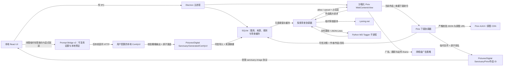

# 纯净领域架构与演进计划

- 文档状态：当前架构基线 + 后续演进计划
- 基线日期：2026-08-24
- 最近同步：找图与整理统一工作台、本地文件夹授权、离线图文索引与原图取用
- 面向读者：接手实现的开发者或代码模型

## 1. 产品边界

纯净领域是本地优先的 Pixiv 安全浏览与二次元图片管理桌面应用。它过滤的是用户明确不欢迎的**画面元素**，不是年龄分级。

必须保持的产品语义：

- 正常 R18、裸体、色情或擦边内容不是默认拦截目标。
- 猎奇、血腥、断肢和当前模型可覆盖的排泄相关元素才进入黑名单规则。
- 未检查完成的远程图片仍保持保护态，但“模型故障”和“真实命中规则”必须是两种不同状态。模型整体不可用时暂停受保护探索并显示一个总故障页，不生成逐图拦截结论。
- 广告过滤与内容过滤是两条独立管线：广告看页面/网络语义，内容过滤看图片本身。
- 个人偏好只来自用户明确点击并确认的标签；一次反馈不足以形成全局拦截，收藏、下载和画廊浏览都不是隐式训练信号。
- 失败闭合只约束远程探索展示和明确要求模型分析的任务；所有已经进入本地画廊的资产都属于可信输入，卡片、相册、画师页、水族馆和大图查看器始终正常显示。模型结果只用于用户主动发起的分类、检索和建议。
- 不在 Electron 内嵌页运行第三方 OAuth，不伪装浏览器指纹，不读取账号凭据或复制系统浏览器 Cookie。

## 2. 当前运行架构



### 2.1 前端 UI

- **找图与整理工作台**：`ImageWorkbench` 在原整理页内提供“我的图库 / 本地文件夹”，不增加一级导航。文件夹默认探索规则，也可选明确元素或画面描述；图库描述搜索沿用 `AnalysisScope`，数据库每次读取 100 张实际图片资产，包含作品各页。每批最多 1,000 张、递归扫描最多 20,000 个目录项，未完成扫描明确警告；结果每次 60 张、跨页选择最多 500 张。按页入册事务与原有导入确认复用，不自动入库或改动源文件。
- **临时文件夹授权**：`ImageWorkbenchService` 持有原生选择的根目录和文件清单；Renderer 只提交窗口绑定的随机会话/图片 ID。扫描跳过链接，预览、分析、复制和准备导入重新校验根与父目录；`sanctuary-image://workbench/<session>/<item>` 返回最大 384px 缩略图，不接收任意路径。一个扫描/分析任务串行运行，最多八个闲置会话、30 分钟过期，离页继续、重启不恢复。标签分析经既有 WD 队列，命中规则只使用成功结果，内容或模型变化使会话标签缓存失效，不写入探索审查结论。
- **离线自然语言排序**：`SemanticClient` 按需启动 `services/semantic/server.py`，使用开发工作区 `.venv-semantic` 与固定官方 EmbeddingGemma 2 快照。UTF-8 JSONL、离线加载、禁用远程代码、启动校验完整文件；仅文字/图像编码器，CPU float32 最多四线程，避免占用探索显存。图像转 RGB 并限 1024px / 40MP，查询最长 500 字，返回归一化 768 维向量。加载 180s / 请求 90s 超时，停止终止进程，闲置 60s 释放；缺环境时禁用入口并说明原因，不联网安装。`userData/semantic-index.db` 是可重建的独立 SQLite WAL 缓存，以 SHA-256 + 模型/预处理版本为键，最多 10,000 条；不存路径或临时扫描清单。相似度只排序，明确元素条件仍调用 WD；当前模型中心与 0.1.2 安装器未集成这一环境。
- **原图取用**：`ImageOutputService` 只接受实际作品/资产或授权会话 ID，目标来自原生目录选择。作品导出包含各静态图片页，缺失原图逐项报错；最多 1,000 张，串行排他复制、同名追加序号、复制前后 SHA-256 校验，失败清理本次副本，保留源文件与已成功项。停止后可重试未完成项，任务为会话级，不承诺进程异常退出后的自动续跑。剪贴板为有界栅格副本：最大输入 32MB / 32MP，解码前读取最多 1MB 文件头，长边最多 4096px，未知格式提示使用原图导出。侧栏任务中心用轻量摘要汇总找图与复制，可停止及返回详情，不轮询图片数组。

- **旧版升级与存储迁移（0.1.2）**：保留安装应用标识和既有绝对路径，旧 `Pixiv/作品 ID` 布局可继续使用。`storage-migration.ts` 只复制索引中的所选根目录图片、缩略图和关联头像，先以 `VACUUM INTO` 备份 SQLite，再排他复制并逐文件校验 SHA-256，最后以事务更新旧页面/资产/缩略图/头像路径；源文件始终保留。不同内容冲突、缺失文件、目录嵌套、子目录链接及复制期间新入库源文件会中止，路径事务失败回滚。相同副本可重试复用；生成结果、备份、导出及外部引用维持原路径。迁移期间拒绝新下载、补头像和再次更改保存位置；设置与侧栏呈现迁移错误。
- **引导首页**：`HomeView` 是启动默认页面，四张任务卡直接进入图库、探索、整理与创作；复用现有导航，不创建中间向导或自动启动推理。侧栏“开始”、Ctrl+0 和快捷操作提供返回入口，Ctrl+1/2/3/4 保持原映射。首页导入实际入库后打开图库，取消文件选择或确认不跳转。
- **本地导入批次**：原生文件选择创建仅主进程持有路径的预览，Renderer 只用窗口绑定的随机批次 ID 操作。确认页就地选择相册，默认校验内容并复用已知指纹或本批相同图片；同名不同内容不会覆盖，同一路径不会重复索引。最多 500 项、单文件 512 MB，逐项流式 SHA256 校验、单图片索引与相册关系事务提交；重复文件会复核当前内容，复用不清空已有分析。支持逐项反馈、停止后保留成功项、只重试失败项、继续浏览与渐进图库刷新。原文件不搬动，不自动分析；旧库未知指纹不在导入时全库回填，任务记录仅保留当前主进程会话。
- 基于 React 19，不依赖厚重 UI 库；建立统一的 **Design Tokens 系统**（基于 CSS 变量的蔚蓝主题色盘、多层级精密阴影、亚克力毛玻璃光影与系统字体中英文排版规范）。
- 渲染样式以 `styles.css` 作为只含有序 `@import` 的清单，实际规则位于 `renderer/src/styles/` 的职责模块中；`electron.vite.config.ts` 会在内存中按清单合成单一虚拟 CSS 模块，以兼顾源码边界、原有级联语义和大图库滚动性能。新增页面样式不得重新堆回清单文件，也不得绕过虚拟入口逐个导入。
- 渲染层按应用壳、画廊、探索、设置、作者、分类和原图查看器拆分。按钮、分段菜单、通知与对话框使用共享组件；对话框统一提供焦点约束、滚动锁定、`Esc` 关闭和忙碌保护。
- **画廊与卡片沉浸感**：顶部采用影院级 Ambient Hero 动态氛围横幅；作品卡片支持多页作品相纸堆叠（Stack Effect）视觉与悬浮升降微交互。
- **影院级大图全貌沉浸查看器（Cinema Lightbox）**：两套图库入口共用 `useCinemaViewer`，完整展示原图；滚轮以鼠标位置为缩放中心，拖动用 refs 保存坐标、每帧至多写一次 transform。1:1 按原图像素与布局尺寸计算，超出通常 5 倍的原图仍可查看；提供首末页、适应窗口、原始像素快捷键、加载反馈和逐层 Esc。焦点约束覆盖查看器、雷达/元素抽屉与上层弹窗，HUD 获焦时保持可见。只低优先级预取前后最多两页，跳过超过 40MP 或 32MB 的原图，省电档禁用预取；关闭时释放预取引用。
- **画集相册（Albums & Artbooks）全景双页对开画廊体系**：将分类相册全面升维为实体艺术画集体验；详情页采用精装对开展台（Spread-based Layout），第 1 展对为卷首题记与封面首作，后续内页左页与右页全部对开展出独立装裱画作；支持两组相互独立的持久偏好——4 种实体装裱风格（典藏相角、和纸手账、画廊浮雕、复古拍立得）与 4 种翻页效果（3D 典藏翻页、平移动画、柔光渐隐、层叠抽拉）；支持通过顶部胶囊与全局键盘快捷键 `T` / `M` 随时唤起【浮动亚克力毛玻璃篇目索引抽屉（Floating TOC Drawer）】进行模糊搜索与原子展对直达。
- **画册 3D 动力学引擎与单一原子状态机（Unified Atomic Spread State Machine）**：采用 0.64s 翻页曲线与 2.4px 厚度微层，将当前展对与转场收敛至单一原子状态机。画册围绕当前展对或翻页目标异步预取邻近画作，最多四张额外图片，省电档停用；不再进入相册即同步解码全部原图，预取引用在离开时释放。
- **画册小窗口**：相册导航在窄窗口分为标题/操作与模式两行，共用画册工具栏将篇目索引、翻页效果、装裱风格各占一行，四种选项完整保留，中文标签不拆成竖排。短窗口的相册书台在舞台内独立滚动，页内容可到达，底部操作栏保持可用；返航同时恢复该舞台的滚动位置和已完成展对。
- **字体排印与自定义字体系统（Typography & Custom Fonts Ecosystem）**：定义 4 大语义化字体槽位（界面无衬线、标题典藏衬线、代码等宽、画册手写体）；主进程内建零依赖 SFNT（TrueType/OpenType）二进制安全解析器与 SHA-256 指纹校验，支持字体文件拖拽/选择导入至 `userData/fonts/` 沙箱，通过受限 `sanctuary-font://` 协议与动态 `@font-face` 实现零重启热注入与个性化排版定制。
- **分类组合与组合视图（Saved Collection Views）**：相册页支持将多个普通相册组合为保存视图；支持多选包含/排除、实时防抖匹配数量与封面预览、拼贴卡片及画廊顶部组合条件摘要栏。
- **目录与范围读取**：相册和画师目录使用 SQL 聚合计数及有限封面，相册最多一张、画师最多三张；组合摘要每次最多 12 条、每条最多四张预览，复用作品级 AND/OR/NOT 查询。点开详情才读取对应相册实际收录页或画师的 legacy 页，按真实作品/资产 ID 分组。没有 legacy 页的作品保留摘要和普通作品入口；未知作者对应数据库 NULL 范围。目录进入普通作品时清空旧搜索、类型、常用筛选和相册条件，摘要数量与打开范围保持一致。
- **分页入册**：相册选图每页 60 张，搜索防抖 180ms、跨页保留选择，“全选当前页”只选择可见候选；一次最多 500 个真实页 ID，在数据库事务中整体校验、一次写入。失败保留选择重试；封面归属使用按 ID 的成员查询。普通画册仍只展示实际入册页，大图则按真实作品 ID 读取全部资产，从点击页开始，共用作品图库查看器。慢详情读取可取消，取消后的旧响应不能重新打开查看器。
- **探索保护**：工具栏只显示模型启动中、保护就绪、模型故障或本次无保护浏览；“浏览保护”面板就地管理规则开关与识别模型，个人偏好、图片测试、精确阈值、自定义标签及统计按需展开。普通开关等待持久化成功后更新，复杂阈值需主动应用；App 持有忙碌状态，关闭/重开面板不能解锁尚未结束的写入。宽窗面板与原生网页分配独立区域，窄窗隐藏网页；弹窗、IME 与关闭后的原生焦点各有归属。只有完整模型结果命中用户规则才累计“拦截”。
- **元素透视与提示词整理**：本地画廊大图的“元素透视”入口复用当前单页 WD 标签，并拆为“看懂画面 / 整理提示词 / 设置探索拦截”。标签百分比只表示模型识别把握，不转换为生成权重；正向 / 忽略 / 负向是当前作品当前页的临时选择，切换作品、页或模型后重置。Danbooru、SDXL 插画与 FLUX 自然语言转换、原始/正向/负向预览、系统剪贴板复制、个人负向词库和主动保存的预设继续可用；只有格式、负向词库和预设按视觉引擎与版本持久化。
- **本地灵感台**：侧边栏可直接进入，也可从两套画廊大图入口把当前页作为参考图带入；灵感台内部另提供可搜索的画廊选择器，多页作品可选具体页，已有对话可更换或移除参考图。第一阶段提供自由聊天、读图讨论、小说片段、角色设定、世界观和提示词笔记六种方式；可按对话从已安装评论模型中选择，不改变模型中心与六维雷达的全局启用项，并用“严谨 / 均衡 / 放飞”和“简短 / 标准 / 详细”映射有界采样参数。发送后用户消息立即作为本段对话的待完成气泡回显，模型思考期间不消失也不串入其他对话。所有任务仍共用单一串行 llama.cpp 进程，不重复占用显存。最多保存 30 段会话、每段 80 条消息，单次只发送最近 16 条且总计不超过 12,000 字符；支持停止和替换最后一次回答。它不是长篇小说工程，尚不承担章节知识库或长期人物记忆；Anomalous 未提供稳定接收协议前不建立假联动。未来的小组件工坊只接受受 Schema 约束的声明式配置，禁止模型生成任意可执行前端代码。
- **ComfyUI 本地桥接**：设置页显式启停、测试回环地址、导入/删除 API Format 工作流；调音台只允许从数据库已索引且存在的本地页显式发起。任务状态持久化，所有返回栅格图经 MIME、体积、文件签名和安全路径校验后原子保存并作为可信资源加入画廊；生成作品的大图可查看来源作品、正负提示词与工作流摘要。
- **三档性能与显示策略**：持久化精致（Quality）、均衡（Balanced）、省电（Efficient）三档，支持 reduced motion 优雅退化；大图库渐进分页与 `content-visibility` 跳过屏幕外绘制。10,000 件元数据夹具最终构建测得首批就绪约 570ms、JS 堆约 15MB，真实图片解码不包含在此测量中，方法与限制见 `docs/reviews/2026-10-03-smooth-experience.md`。
- **有限点击反馈**：应用壳通过 React 捕获统一装饰共享按钮、首页任务卡与导航；Web Animations 的独立 scale 在 150/190ms 内结束，快速连点取消上一段，不延迟业务事件、不读取布局、不增加 React 状态或动画依赖。应用与系统的减少动画、省电策略覆盖 body portal，保留画册状态机的 `animationend`，装饰性弹层与按压停止运动，焦点和颜色状态仍可见。
- **查询、返航与快捷操作**：`LibraryQueryController` 单独管理请求代次和分页锁，非空搜索防抖 180ms，旧请求不能覆盖新结果；刷新按最多 200 件的批次保留已加载范围。图库模式各自记住滚动位置，作品卡片使用 `memo` 与稳定回调，避免新增一页时重渲染所有旧卡。设置、整理、创作及部分弹窗按需加载。Ctrl+K 与侧栏入口打开同一个可搜索操作面板；原生探索只经 Electron `before-input-event` 向应用发送开启事件，取消时经窄 IPC 恢复原生焦点。
- **详情返航**：`GalleryDetailSessionCache` 在 App 会话内按真实相册/画师范围保存最多 20 个 LRU 快照，记录合法浏览子模式、已完成画册页锚点，以及各列表和 TOC 的位置。导航前同步捕获；详情数据和 DOM 就绪后才恢复，优先定位原资产，删除时回退邻页或有效序号。目录与详情滚动分开；恢复坐标换算为 CSS 像素，最多三帧复验屏外卡片展开后的布局；用户开始滚动会取消待执行的恢复。滚动期间复用当前范围的 DOM 索引，仅按帧捕获，不重渲染整页。快照只含有界 ID 和数值，不保存图片数组、路径、DOM、搜索、弹窗或动画；重启后不保留，持久作品续读仍由 `WorkReadingProgress` 单独承担。
- **常用筛选与续读**：全部、喜欢、最近浏览、未分相册复用同一作品查询及计数，和搜索、类型、画师、相册条件组合。最近浏览临时采用浏览时间倒序，离开后恢复普通排序；快捷操作面板的预设直达会清空旧范围条件。封面续读与显式页点击分别选择保存页和点击页，只在原图成功加载后记录；快速翻页用 500ms 合并，关闭立即隐藏并在后台保存最后加载页、刷新列表。
- **作品信息**：两种大图共用 `WorkInformationDrawer`，从“作品信息与工具”查看来源、文件、已有相册与保存的识别/画评，并归档整件作品。只读请求不启动模型；原始标签、模型版本、文件路径与生成提示词按需展开。元素透视、画评和携图创作从同一作品上下文明确进入。信息层复用 `DialogOverlay` 的焦点/输入法/Esc 边界，背景翻页暂停；读取代次阻止旧作品回包覆盖当前信息。
- **图库显示名称**：同一信息层提供显式改名，多页共用作品名称。`WorkNameStore` 的 schema 7 增加 `works.custom_title`，同时更新查询使用的 `works.title`；来源标题仍保留在旧页面记录，后续重新导入、下载元数据补齐或追加页不会覆盖自定义名称。旧页面查询投影可选 `displayName`，相册、画师、选图器和普通图库复用同一名称；窄 IPC 只接受作品 ID 和有界名称，不接收文件路径，不重命名物理文件。
- **探索页面切换**：侧栏在同一窗口宽度下保持跨页面等宽，不再用网格宽度过渡或整页位移动画移动原生网页宿主。`ExploreView` 在布局阶段测量，网页实例保持复用；宽窗工具展开只同步实际变化的边界，弹窗/窄窗遮挡才隐藏，迟到的显示响应不能恢复过期状态。原生视图使用白色背景，侧栏滚动槽为透明底细滚动条；远程审查与下载边界沿用原有保护逻辑。
- **保存筛选**：图库常用筛选旁可保存/恢复搜索、类型、喜欢/已浏览、画师、包含/排除相册与排序。`library.savedWorkFilters.v1` 在 SQLite 偏好中保存最多 30 条合法条件，名称唯一，移除分页字段；恢复替换当前条件并从第一页查询，结果随图库变化。失效相册保留原 ID，不静默放宽查询；删除筛选不删除图片，与按相册组织的既有组合视图保持原语义。
- **任务入口**：侧栏与快捷操作共用按需加载的 `TaskCenter`，汇总当前导入、下载、缩略图轮次与最近 30 条批量识别。识别摘要只读任务行与索引失败计数，不展开图片结果或计算相册建议；后台每 5 秒、打开时每 1.5 秒串行刷新，旧请求不更新，状态未变不引发图库重渲染。下载在离开探索后继续接收进度；非探索页面忽略不相关的网页计数更新。任务页只提供真实支持的启动、停止、导入结果/失败重试和补图重试；下载回到探索与保存位置，不伪装暂停或原任务恢复。返回整理台定位对应建议任务，打开/关闭任务层处理原生视图隐藏与焦点恢复。关闭应用后不承诺导入、下载、补图续跑，识别任务沿用持久化和中断恢复语义。
- **创作结果保存**：稳定回答可复制正文或保存 Markdown，会话可复制和导出；实际模型、版本、参数、参考页及本轮耗时按每条回答存储，旧回答明确标注来源未记录。慢回复完成只更新原会话，保留当前工作区和草稿；删除会中止对应请求，失败或停止重新生成保留原回答。
- **创作窗口布局**：聊天与输入区按主页面的可用高度收缩；小窗口保留两列，历史和模型/玩法分别滚动，消息容器使用 `min-height: 0` 与滚动隔离。新回答只滚动消息容器，不再用 `scrollIntoView` 滚动页面祖先，80 段长文也不撑高聊天框或推走输入区。
- **动态主题引擎与个性化外观系统（全栈完成）**：前端视觉 tokens 与个性化样式解耦为标准化主题包（`theme.json` + `theme.css`）。主进程支持内置/用户主题扫描、文件夹与受限 ZIP 原子安装、活跃主题持久化、安全 CSS 读取、删除回退，以及带本地缓存和限流熔断的 GitHub Contents API 商店；渲染层实现 `<style id="ds-dynamic-theme">` 零刷新无缝热注入；开箱提供 4 套官方深度定制预设（庇护所标准蔚蓝、绝区零 Hollow Zero 潮酷暗调、樱落梦境 Sakura Dream 二次元粉彩、赛博终端 Cyber Deck 霓虹矩阵）；支持用户在设置中心自定义上传个人头像并同步展示于侧边栏品牌区。
- **360° 交互式动力学星盘罗盘（Interactive Compass Dial）**：放在“设置 → 外观与显示”，图库首屏优先展示作品；采用三角函数极坐标（`Math.atan2`）捕获鼠标转圈拖拽手势，驱动多层差速齿轮（Parallax Differential Rings）、发光磁性指针、12点钟基准对齐指示箭头与物理惯性阻尼衰减（Momentum Damping），实现 360° 无级旋转拨盘换肤互动。

### 2.2 Electron 主进程

- `apps/desktop/src/main/index.ts`：当前仍是组合根，负责窗口、IPC、Pixiv 视图、网络拦截、远程图片审查、下载协调和视觉进程生命周期。
- 主进程启动时申请 Electron 单实例锁；重复启动只唤醒现有窗口，不创建第二个 Pixiv session/view。
- `apps/desktop/src/main/explore-policy.ts`：可单元测试的 URL、权限、广告和资源策略。
- `apps/desktop/src/main/pixiv-dom-adapter.ts`：幂等注入拦截占位层、“仅本次查看”和作品页下载按钮。宽泛的第一方 PR/BOOTH DOM 猜测已经移除，避免再次误伤普通作品。
- `apps/desktop/src/main/thumbnail-service.ts`：独立的版本化缩略图批处理器。每次只串行处理小批资产，同一数据库的重叠请求共享进行中批次，缓存文件缺失时迭代找到本批所需项即停止。Renderer 只有一条后台补图循环，不随搜索重启；首批、每十批和结束时更新可见封面。
- `apps/desktop/src/main/local-import-service.ts` 与 `local-import-ipc.ts`：原生选择授权、窗口绑定批次、异步逐图指纹和有界结果；数据库使用已有资产指纹列及部分索引，图像与入册原子提交。无 Renderer 自由路径写入接口。
- `apps/desktop/src/main/saved-collection-view-ipc.ts`：分类组合 CRUD 的运行时校验与 IPC 边界，限制名称、条件数量、ID 长度及包含/排除冲突。
- `apps/desktop/src/main/theme/`：主题清单/商店协议校验、CSS 与路径安全边界、ZIP 解包、原子安装管理、GitHub 商店缓存代理和主题 IPC；服务在首次主题请求时才扫描目录，不阻塞首屏窗口创建。
- `apps/desktop/src/shared/pixiv-download.ts`：Pixiv 页面上下文、AJAX 响应和原图 URL 的纯函数校验。
- `apps/desktop/src/shared/bounded-concurrency.ts`：下载任务使用的通用并发门。收藏作品按顺序处理，单作品内部原图最多四路；Pixiv JSON API 全局间隔至少 800 ms。
- **有界重试**：429、网络异常和 5xx 最多重试两次，单次等待不超过 30 秒；仍失败时抛出批次级错误并停止，不把同一全局故障记成数百个作品失败。
- **连续失败熔断**：下架或无权限作品可以单项跳过，但连续 5 项失败自动停止。403 不再盲目等待 15 分钟。
- **结果语义**：零失败才显示“下载完成”；有成功也有失败时显示“部分完成”，作品进度按“已处理 = 成功 + 失败”计算。
- `apps/desktop/src/main/explore-review-queue.ts` 与 `apps/desktop/src/preload/explore.ts`：生产使用的视口优先审查。document-start 保护样式阻止未知图片闪现，只有接近视口的作品进入有界队列；结果分为 `allowed / blocked / unavailable`。
- `apps/desktop/src/main/explore-preference-calibration.ts`：承载双向显式校准。误拦截会记录具体 Pixiv 页放行例外并小幅上调真实命中标签阈值；“少看类似”会记录具体页隐藏例外，并按用户确认的 WD 标签渐进累积模型版本隔离的个人权重。两种事件都保存旧值、新值与证据次数，支持即时撤销。
- `apps/desktop/src/main/vision-client.ts`：版本化 JSON Lines 客户端、启动就绪握手、模型身份校验、真实小图推理、超时和子进程错误状态机。
- `apps/desktop/src/main/prompt-bridge-ipc.ts`：Prompt Bridge v2 可复用设置的模型版本隔离持久化与系统剪贴板窄 IPC；读取旧 v1 时只迁移格式、负向词库和预设，丢弃旧的跨作品标签取向。
- `apps/desktop/src/main/inspiration-ipc.ts`：本地灵感台的窄 IPC、创作预设、输入校验、有界会话持久化和取消控制；Renderer 只能提交已索引作品 ID，主进程重新解析实际图片路径。
- `apps/desktop/src/main/inspiration-export.ts`：只接受已保存会话/消息 ID 的输出链路；主进程重新读取内容、写系统剪贴板或打开原生 Markdown 保存对话框，再以临时文件原子改名保存。Renderer 不提交输出路径或任意写入内容，导出不嵌入图片和本地路径。
- `apps/desktop/src/main/comfyui/`：本机回环 URL 校验、API 工作流结构/危险路径校验、受限 HTTP 客户端、串行持久任务、输出回收和 IPC。模板可用 `{{positive_prompt}}` / `{{negative_prompt}}` / `{{source_image}}` 显式绑定，也会窄范围识别标准 `CLIPTextEncode` 与 `LoadImage` 节点。
- Pixiv 使用 `persist:pixiv` 独立持久化 session；本地 React 渲染器不能访问其 DOM 或 Cookie。画师馆藏的 Pixiv 深链接只提交受限数字画师 ID，由主进程拼出官方用户页并在应用内探索视图加载；单实例锁避免多个进程造成“登录一次却看似丢失会话”的错觉。

### 2.3 视觉与领域层

- `services/vision/python/`：WD SwinV2 Tagger v3 推理实现。
- `packages/domain/`：元素组、阈值、标签映射、SavedCollectionView、`allow / blur / hide` 决策，以及 Prompt Bridge / ComfyUI 的领域契约与确定性提示词转换。
- `packages/protocol/`：桌面端与视觉子进程之间的协议。
- `packages/database/`：本地图库、自定义画廊分类（含封面绑定）、分类组合视图、独立画师表（含头像快照）、Pixiv 作品来源、元素规则设置和远程审查缓存；Migration 5 新增 `comfyui_jobs` 与 `generation_provenance`，分别保存生成任务状态和结果来源。组合视图的 schema、CRUD、唯一名称约束和损坏 JSON 降级集中在 `saved-collection-view-store.ts`。
- `queryWorks` 通过物化分页 CTE 先确定作品 ID 与排序值，再读取本页封面、资产体积和相册关系，保留 NULL 置后、NOCASE 与 ID 同值排序规则；非搜索计数不连接画师。缩略图/头像路径及补图队列使用非空部分索引，既有数据库重开时补齐，不改变 schema version。导入返回按 ID 读取，继续复用旧版字段映射。
- `recordWorkView` 使用现有 `works.last_viewed_at` 和 `library.readingProgress` 偏好，不升级 schema；只接受归属正确、可用的图片资产 ID。每件作品保存一项位置，最多 100 件；失效资产、删除作品和损坏记录会清理。浏览时间另有部分索引，NULL 仍置后；不改变保存时间、修改时间或模型分析数据。分页去重后按实际返回条数推进 SQL offset，避免并发插入导致重复页卡住。
- `library-directory-store.ts` 使用分组聚合及排名预览读取相册/画师摘要，保存组合每批最多 12 条；不从 Renderer 整库筛选，也不为每张普通目录卡执行一次作品查询。`GalleryDirectoryController` 隔离目录与详情的请求代次，隐藏/切换后旧结果不能写入当前范围，组合分页使用锁和实际返回 offset。范围 legacy 页带有 `libraryWorkId` / `assetId` / `pageIndex` / `thumbnailPath`；不以文件名推断来源。详情当前仍读取单个范围的完整页元数据，以保留完整画册和 TOC；超大单范围的 manifest 分页及详情位置快照属于后续工作。
- 开发环境检测到 `.venv-gpu` 时优先请求 CUDA，初始化失败回退 CPU。RTX 4050 基准中单图中位数约由 463 ms 降至 72 ms；provider 选择不改变模型版本和缓存语义。

## 3. 当前探索请求流

1. Pixiv 请求普通界面图片、头像或登录素材：直接放行。
2. 请求命中广告/追踪域名：网络层取消，并增加“广告拦截”计数。
3. 请求是非 Pixiv 第三方 iframe：默认取消；`accounts.pixiv.net` 登录页所需的 reCAPTCHA 是窄例外。
4. 请求是视频：当前失败闭合并取消。
5. 请求是 `i.pximg.net` 的 `img-master`、`img-original` 或 `custom-thumb` 作品图：
   - 相同 URL 在进程内去重；
   - 先按规范化 URL、引擎、引擎版本和规则指纹查询持久化缓存；
   - 缓存命中完整结果时直接决定 allow/block，不下载或重复推理；用户明确标记的具体作品页放行/隐藏例外优先处理；
   - 带 Pixiv `Referer` 下载不超过 12 MiB 的临时副本；
   - 只有接近视口的作品才进入串行 WD Tagger 队列，避免屏幕外图片占用算力；
   - 先使用数据库中的当前元素规则判定；硬规则未命中时，再计算个人标签画像的组合分。个人画像至少需要重复证据，一次“少看类似”不会全局隐藏其他作品；
   - `allow` 正常显示；完整结果命中规则才产生 `blocked` 遮罩；单张下载或推理错误返回 `unavailable`，不得显示成“已拦截”；
   - 遮罩提供“仅本次查看”和“这张不该隐藏”。后者永久记录具体页例外，同时透明展示对应标签阈值或个人权重的旧值、新值，并可撤销；
   - 已放行作品悬浮时提供“少看类似”。远程页面只能选择主进程从该图已保存 assessment 中给出的最多 16 个候选标签，最多确认 5 个；通用构图/人物数量标签不会默认勾选。用户也可以只隐藏当前页而不学习标签；
   - 推理后删除临时文件。

当前未命中缓存时仍会为审查下载一次图片、放行后由页面再下载一次。它是安全的最小闭环，但不是最终的网络效率形态。

### 3.1 当前 Pixiv 下载与画廊流

1. 只有作品详情页允许“保存当前作品”；只有收藏作品页允许“下载全部收藏”。网页内按钮携带的作品 ID 必须与当前顶层 URL 一致。
2. 主进程通过登录 session 获取作品页清单、作者信息和公开/非公开收藏 ID；所有 JSON 响应和 `i.pximg.net` 原图 URL 都经过严格校验。
3. 原图请求绕开探索页内容拦截器，使用 Pixiv 作品页 `Referer`、流式临时文件和原子改名；全局网络并发上限为 4。
4. 文件保存在用户“图片/Digital Sanctuary/Pixiv/作品 ID”中；已索引页码连续、文件存在且作者资料已经入库的作品触发本地快速跳过。所有 Pixiv JSON API 请求接入 800 ms 全局节流。
5. 所有用户主动下载都调用 `trustArtwork`：清除旧模型结果并保存明确的 `allow` 决策，不自动运行 WD Tagger。
6. SQLite 保存 `workId`、`pageIndex`、`authorId`、`authorName` 和标题；分离画师实体独立入库。头像不再猜测作品 JSON，而是从 `/ajax/user/:authorId?full=1` 的 `imageBig` 获取并保存本地快照；画廊也提供不重下作品的显式补全入口。
7. 本地图片仅通过 `sanctuary-image` 自定义协议返回，并且只有数据库已索引、文件仍存在的路径可以读取。
8. 画廊提供基于分类组合（Saved Views）的虚拟布尔筛选（AND / OR / NOT），支持多分类复合查询，不复制或修改底层作品文件与分类实体。

## 4. 安全不变量

- `contextIsolation: true`、`nodeIntegration: false`、`sandbox: true`、`webSecurity: true`。
- 顶层导航只允许 HTTPS `pixiv.net` 及子域。
- 弹窗、下载和权限默认拒绝；例外必须是可测试的窄规则。
- 远程 Pixiv 页面不获得本地文件、数据库、视觉进程或通用 IPC 权限。
- “少看类似”的标签、置信度和旧画像都由主进程从当前模型版本的已保存 assessment 重新核验；远程页面不能提交任意标签或直接设置权重。
- 系统浏览器入口只能打开代码中固定的 Pixiv 官方密码设置 URL。
- 过滤规则变化后必须使旧的远程审查缓存失效。
- 任何缓存键必须包含模型/引擎版本和规则指纹；规则指纹同时覆盖硬规则、适应阈值与个人画像摘要，不能把旧模型或旧画像的 `allow` 永久复用。
- 被拦截图片在完成判断前必须保持保护态；一次性查看不能改变持久规则。“这张不该隐藏”是独立的明确学习操作，必须保存具体页例外、显示阈值变化并允许撤销。
- 视觉进程只有在模型装载握手和启动推理都成功后才可以标记 ready。模型故障必须暂停受保护探索；用户只有显式选择后才能进入当前会话的无保护浏览。
- 远程 Pixiv 页面不能直接指定下载目标路径；所有作品 ID、原图域名、扩展名、文件上限和落盘目录由主进程重新验证或生成。
- ComfyUI 只接受 `http://localhost`、`127.0.0.0/8` 或 `[::1]` 回环根地址，禁止账号、远程主机、额外路径、查询和片段；桥接默认关闭，只有用户显式开启后才允许入队。
- ComfyUI 工作流限制为 2 MiB / 1,000 节点，拒绝本机绝对路径、上级目录跳转、危险键名与无正向提示词绑定；无需参考图的模板不会上传图片。返回 JSON、图片数量、图片体积、MIME 与文件签名都有上限。
- “用户信任”和“模型分析”是不同概念。未来的图库整理模型只能写标签或建议，未经用户确认不能把主动下载作品改为模糊/隐藏。

## 5. 广告过滤分层

广告过滤不能与元素黑名单混为一谈：

1. **网络级过滤（已实现并保留）**：拦截已知广告/追踪域名和站外 iframe，降低请求数与渲染进程数。
2. **Pixiv 第一方美容过滤（冻结）**：旧的 DOM 祖先猜测曾引发 KI-0003，把普通作品列表整块隐藏，现已移除。第一方 PR/BOOTH 卡片可能继续出现，当前优先使用 Pixiv Premium 官方广告开关；若以后恢复，必须采用标准规则引擎或有夹具覆盖的精确适配器。

第一方广告与普通作品共用 Pixiv 域名和图片 CDN，不能封禁整个 `pixiv.net`/`pximg.net`，也不能把广告插画当作不欢迎元素送入 WD Tagger。

## 6. 主进程模块边界

发布收尾已经抽出并测试以下稳定边界：

- `window-state.ts`：多显示器窗口状态校验与安全收敛；
- `library-ipc.ts`：作品查询、详情读取和缩略图批任务 IPC；
- `gallery-directory-ipc.ts`：相册/画师/组合摘要、必选实体范围、分页候选与有界批量入册；共享 parser 拒绝无条件 all 范围、路径和无效整批页 ID。旧 `library:list` / 单页入册返回整库的兼容接口仍在，但新目录与选图流程不调用。
- `saved-collection-view-ipc.ts` / `packages/database/src/saved-collection-view-store.ts`：分类组合输入校验、IPC 注册与 SQLite 持久化；
- `analysis-ipc.ts` / `analysis-job-runner.ts`：显式分析 API 与严格串行、可取消的执行器；
- `model-center/catalog.ts` / `model-center/model-center-service.ts`：受信任模型清单、断点下载、文件大小与 SHA256 校验、受控安装目录、能力分组和当前模型切换；
- `explore-policy.ts`、`explore-review-queue.ts`、`pixiv-dom-adapter.ts`：导航/广告策略、审查队列和远程 DOM 适配；
- `shared/pixiv-download.ts` / `shared/bounded-concurrency.ts`：Pixiv 响应解析、下载状态和并发原语；
- `thumbnail-service.ts`、`vision-client.ts`：缩略图缓存和模型子进程协议。

`index.ts` 仍负责 Electron 生命周期和需要共享 Pixiv session 的下载/探索协调。继续迁移时沿用下面的控制器目标，不在发布收尾阶段重写已经通过回归的远程请求链路。

在继续扩大功能前，将 `apps/desktop/src/main/index.ts` 中的探索逻辑逐步迁移为：

```text
apps/desktop/src/main/explore/
  controller.ts              # WebContentsView 生命周期与状态汇总
  navigation-policy.ts       # 顶层导航、弹窗、权限和下载
  adblock-policy.ts          # 广告域名和站外 iframe 策略
  pixiv-url-adapter.ts       # 作品 CDN URL 识别与规范化
  pixiv-dom-adapter.ts       # 第一方 PR 卡片、占位层和页面结构探针
  review-coordinator.ts      # 去重、排队、下载、判定和统计
  review-cache.ts            # SQLite 持久化审查缓存
  types.ts                   # ExploreState 等共享主进程类型

apps/desktop/src/main/download/
  controller.ts              # 单作品与收藏任务、进度和取消边界
  pixiv-api.ts               # 登录 session 下的 Pixiv AJAX 访问
  original-fetch.ts          # 原图流式下载、限流、临时文件与原子改名

apps/desktop/src/main/library/
  controller.ts              # 导入、可信下载入库与显式模型整理入口
```

迁移必须小步进行：先复制测试覆盖，再移动代码，不要一次性重写 `index.ts`。

## 7. 持久化审查缓存计划

SQLite 已增加并使用 `remote_image_reviews`：

```sql
CREATE TABLE remote_image_reviews (
  normalized_url TEXT NOT NULL,
  content_hash TEXT,
  engine TEXT NOT NULL,
  engine_version TEXT NOT NULL,
  rules_fingerprint TEXT NOT NULL,
  assessment_json TEXT NOT NULL,
  decision_json TEXT NOT NULL,
  byte_length INTEGER NOT NULL,
  reviewed_at TEXT NOT NULL,
  PRIMARY KEY (normalized_url, engine, engine_version, rules_fingerprint)
);
```

实施要求：

- 只缓存完整、可解析的审查结果；网络错误和模型错误不应成为永久记录。
- 规则指纹由启用状态、标签、阈值和动作的稳定序列计算。
- 非空个人画像的标签、权重、证据次数与启用状态追加到规则指纹；空画像保留原指纹，避免无意义地废弃历史缓存。
- 模型或标签表版本变化时不能复用旧结果。
- 设定容量/时间清理策略；不要永久保存远程图片文件。
- 若未来用内容哈希跨 URL 复用，仍要验证响应内容，不能只相信 URL 参数。
- 当前默认在应用启动时清理超过 30 天或超出 2,000 条的记录；只保存 `status=complete` 结果。

## 8. 显式模型整理边界

模型整理使用 `analysis_jobs`、`analysis_job_items` 和 `analysis_asset_results`，不复用旧 `artworks.assessment_json` 作为画廊展示信任：

- 只有用户预览范围并点击开始后，任务才进入串行模型队列；启动、滚动和下载不会触发任务。
- 范围保存为不可变的作用域快照；任务项落实到当时可用的本地图片资产。
- 资产更新时间、引擎及当前客户端提供的引擎版本一致时可以复用完整分析；文件、引擎或版本变化后重新推理。范围预览在 SQL 中按作用域计数，不将整个图库 ID 列表展开为占位参数。
- 取消在当前单张推理结束后生效；异常退出会把 `running` 任务标为失败，不自动恢复运行。
- 标签建议与探索拦截、主动下载信任完全分离；只有用户勾选并确认的建议才创建分类关系。
- 整理台默认“按探索规则排查”；“按特征查找”和“推荐相册分类”独立分流，范围与精确参数按需展开。`analysis:triage-explore-rules` 只接受合法作用域，由主进程读取当前元素规则、自定义组和当前模型专属校准阈值；SQLite 只匹配完整、当前模型/版本及图片版本的分析记录，不改图库展示决策。响应给出启用规则名称及已分析/可分析图片数量，未分析不能冒充没有命中。远程单页例外与个人标签偏好不是本地清理规则。
- 排查结果每次展示 40 件，逐步展开；全选仅选择已展示项，每批最多选择 500 件，与删除 IPC 的上限一致，达到上限仍可取消选择。配置变化和离开页面使旧查询失效，失败后可重试。入册每批最多 8 个并发请求，部分失败保留选择；删除仍需要生产范围预览与二次确认，反馈区分完成与失败。分析任务只在存在待运行任务时轮询，空闲整理页不持续查询任务列表。
- 本地画廊展示层不读取 `allow / blur / hide` 来决定可见性；既有旧决策可以作为分析记录保留，但不能再生成视觉遮罩。

### 8.1 标签语义与本地生成边界

- Prompt Bridge 与探索个人偏好只共享 WD 标签名称，不共享用户动作：探索偏好决定远程遮罩；本图正向 / 忽略 / 负向只决定当次导出文本；任何一方都不能改变本地画廊可信显示。
- 本图标签取向不持久化，切换 `workId + pageIndex` 或模型后按识别把握重新建立默认值。`engine + engineVersion` 只隔离输出格式、个人负向词库和主动保存的预设；所有转换是可测试的确定性规则，不暗中调用在线模型。
- 标签百分比只负责候选筛选与排序，不生成 `(tag:weight)` 权重。真正的生成权重应由用户在后续生成工具中明确决定，不能拿分类模型置信度冒充。
- ComfyUI 任务必须引用现存 `workId + pageIndex + templateId`，主进程重新解析本地资产路径，Renderer 不能提交任意文件路径或任意落盘目录。
- 生成任务严格串行；异常退出把旧 `running` 任务标为失败，不自动重跑。取消只停止本地等待并明确提示 ComfyUI 端可能仍在执行。
- 每个返回输出建立独立可信画廊作品和 `generation_provenance`；来源删除时相应来源记录级联清理，但不会让探索规则反向作用于生成资源。
- 区域级遮罩未接入生产。当前 WD Tagger 没有坐标，准确率、显存与延迟门槛见 `docs/research/REGION_LEVEL_MASKING_GATE_2026-08-24.md`。

### 8.2 模型中心与视觉雷达运行边界

- 安装包继续只携带日常所需的 WD SwinV2 基础模型；模型中心不会在首次启动时静默下载数 GB 权重。其他模型必须由用户明确点击安装。
- 可下载模型来自代码内受控清单，下载地址必须是 HTTPS，文件名、声明大小和 SHA256 都通过后才能从暂存目录进入正式模型目录。中断保留 `.part` 文件供续传；不能把任意 URL 或任意磁盘路径交给 Renderer。
- `element_tagging` 模型切换会重启同一个视觉客户端并执行 ready 握手与启动探针。新模型启动失败时尝试恢复原模型；已保存选择丢失或文件不完整时自动回退内置模型。
- 画廊大图的“本地技术画像”是用户主动触发的确定性图像统计，只保存到 `vision_evaluation_results`，不影响画廊显示、探索规则或个人偏好。
- Python 视觉子进程与 Electron 之间的 JSONL 标准输入输出固定为 UTF-8，不继承 Windows 控制台代码页；固定套件维度名在 IPC 校验和数据库读写时都由领域注册表规范化，因此旧缓存中的乱码标签也会在读取时恢复。
- “AI 美术六维”可使用已启用的外部视觉服务，也可使用模型中心显式安装并启用的本地 Qwen3-VL / Gemma 4 评论模型；Gemma 4 E2B Q4 为流畅档，E4B Q4 为高质量推荐档，均不随安装包静默下载或自动替换当前选择。结果永久记录 provider、model、套件、提示词与预处理指纹，失败结果不进入长期缓存。
- AI 画评先返回“画面阅读”再评分：`observation` 只保存直接可见事实，`interpretation` 明示为主观推测，视觉落点与不确定项分别保存；这些字段与六维结果一起进入 SQLite。提示词协议版本写入缓存指纹，因此旧结果继续可读，但不会阻止用户生成带画面阅读的新结果。
- 本地 llama.cpp 请求不仅声明 `json_object`，还携带与固定/自选套件对应的 JSON Schema，约束画面阅读字段和恰好六个维度。返回层可恢复代码围栏、普通说明前后缀、JSON 字符串包装、常见结果包装层及尾逗号，但恢复后仍必须通过原有维度与证据门禁；达到长度上限、普通拒答和其他格式异常分别报告，不保存失败结果。
- 每件作品的雷达结果按 suite 收敛：本地技术画像、标准六维和 AI 自选六维各保留/显示最新一项。重新分析或更换评论模型会替换同类旧结果；历史数据库即使已有重复项，列表查询也只返回每类最新项，避免侧栏随使用时间无限增长。
- 本地评论模型由独立 llama.cpp 回环子进程承载，只监听随机 `127.0.0.1` 端口并使用随机 API Key；启用先做健康自检、推理严格串行、闲置 2 分钟或显式停用后退出。其故障域与探索 WD Tagger 完全隔离。
- 本地灵感台复用上述评论模型进程与严格串行队列，不启动第二份权重。每次请求可以解析一个已安装的评论模型 ID，但不会写入 `models.active.art_critic`，因此不改变雷达的全局选择；不同模型之间切换时同一进程有序卸载/加载。对话、模型选择和通俗生成档位保存在已有 `user_preferences` 中并在写入时裁剪；图片每轮由主进程从可信画廊索引重新定位和缩放，Renderer 不传文件路径。
- 外部模型仓库名不是模型身份。可下载评论模型的 URL 必须锁定完整仓库提交号，不使用可漂移的 `main`；文件名、精确字节数和 SHA256 同时匹配后才能安装。仓库改名只影响远程解析，已安装的本地目录继续按内部 model ID 与版本运行。
- 固定六维套件适合相对比较；`external_adaptive_highlights` 允许模型按单张作品自行命名恰好六个轴。模型误把中文显示名写入内部 key 时，适配层会生成稳定的安全 key；多返回 1 至数项时按模型分数保留最高六项。修复后仍须通过唯一标签、具体理由、有效分数、非全零和严格 JSON 门禁，少于六项时不凭空补造，也不能假装成可跨作品统一排序的客观尺度。
- 轻量美感分类头仍只进入受信任目录展示并标记“运行时待接入”；在其特征提取器和标签语义完成验证前不得伪装成可安装或可启用。
- 详细能力矩阵、落盘规则和后续门槛见 `docs/design/MODEL_CENTER_AND_RADAR_RUNTIME.md`。

## 9. 近期架构里程碑

### 用户入口与能力归属（2026-10-04）

Renderer 主导航提供开始、图库、探索、创作、设置。`app-navigation.ts` 定义导航与设置分类；启动默认进入引导首页，图库内的“浏览作品 / 整理与分类”共享同一主导航归属。从多选作品进入时直接打开相册分类建议，并保留选中范围，不自动启动推理；从首页或普通整理入口进入时默认按探索元素规则排查。

`SettingsView` 按图库与存储、外观与显示、模型管理、高级连接四个用途分组；原“探索保护”路由别名、侧栏状态和快捷操作统一回到探索面板。`SettingsDisclosure` 初次展开才挂载字体、头像、拨盘、备份迁移及外部服务表单，关闭或切换分类时保留已挂载实例和草稿，离开设置页后卸载。`ModelCenterView` 在模型管理里保留统一文件管理，在探索面板内可限定元素识别能力；日常目录只呈现已接入的探索识别和画评/创作两类，资源细节收起，模型写操作串行。创作页保留本次模型选择和缺失模型安装入口。

相册和画师的全部四种模式收进 `BrowseModeMenu`；共享画册的四种装裱与四种翻页效果收进“展示选项”，两组偏好仍独立持久化，菜单展开不保存到返航快照。两套大图入口共用 `ArtworkToolsMenu`，将雷达、元素透视和携图创作收进“分析与创作”；选择动作后收起，菜单拥有键盘输入和第一层 Escape。探索原生视图边界在主进程按调用方 WebContents 的真实 zoom factor 将 CSS 像素转成 Electron DIP，不使用屏幕像素比重复乘 DPI；Renderer 的界面缩放不再被 body 的 900px 最小宽度撑出视口。既有窄 IPC、失败闭合和本地资产信任边界继续保留。

1. **已完成**：元素黑名单、远程失败闭合、持久化审查缓存、占位层和一次性查看。
2. **已完成**：作品全部页保存、公开/非公开收藏批量下载、四路限流、原子落盘、去重与来源元数据。
3. **已完成**：主动下载信任边界、原图懒加载、平铺/作者两级浏览和沉浸式大图层。
4. **已完成**：MVP 画廊资产管理重构，引入独立 `ArtistRecord`（本地头像）并扩展 `CollectionRecord`（自定义封面与分类详情浏览）。
5. **部分冻结**：第一方广告美容过滤及宽泛 DOM 方案不得恢复；视口审查已在状态分离、故障门和回归测试补齐后重新启用，仍需真实站长滚动验收。
6. **已完成**：作品级数据迁移、数据库查询/分页、安全删除、共享交互组件以及画廊/探索/设置组件边界。
7. **已完成**：版本化缩略图、自动分页和屏幕外绘制跳过已经接入；真实 Electron 10,000 作品基准覆盖首屏、连续触底、内存门槛和图片元素计数。
8. **已完成**：模型整理采用显式范围预览、持久任务、取消、缓存和二次确认的分类建议流程；分析结果与展示信任状态分表保存。
9. **已完成**：UI/UX 现代化二次元极简设计系统重构；引入 Design Tokens、影院级 Ambient Hero、多页作品相纸堆叠视觉、大图悬浮控制台与探索防线雷达 HUD。
10. **已完成**：主进程模块化拆分、一致性备份与 Windows 打包验收。
11. **已完成**：分类组合与组合视图（Saved Collection Views）；支持多分类交集（AND）、并集（OR）、排除（NOT）复杂查询与实时防抖预览，数据库迁移至版本 3。
12. **已完成**：动态主题生态与 360° 动力学星盘罗盘；支持标准化主题包安装、GitHub 商店与物理惯性拨盘换肤。
13. **已完成**：字体排印与本地自定义字体系统（Typography）；4 大语义化槽位、SFNT 安全二进制解析器、`userData/fonts/` 沙箱、`sanctuary-font://` 协议与动态热注入。
14. **已完成**：双页对开画册（Double-Spread Photobook）与 3D 翻页原子状态机；4 种装裱风格、浮动目录抽屉及有界邻页预取。
15. **已完成并实机验收**：画廊可信显示、模型 ready 握手与启动推理、探索全局故障门、视口审查重新启用，以及“这张不该隐藏”的具体页例外、按标签渐进校准和即时撤销。
16. **已完成并实机验收**：探索双向个人偏好学习；包含“少看类似”候选标签层、具体页隐藏、重复证据门槛、个人组合分、模型版本隔离画像、透明数值反馈、撤销及设置页启停/重置。本地画廊继续完全不读取该画像。
17. **已完成并实机验收**：元素透视三页工作区与 ComfyUI 本地桥接；包含识别把握说明、本图临时三态、模型适配提示词、复制/负向词库/预设、本机连接与工作流模板、持久生成任务、多输出回收、可信入库和来源查看。区域级遮罩独立评审未过门，保持不实现。
18. **已完成第二阶段并通过本地实机烟雾测试**：模型中心、受控下载校验与安全运行时展开、WD 系列模型热切换与失败回退、本地技术画像、外部固定六维，以及 Qwen3-VL 本地标准/自选六维评论、结构化结果拒绝门禁和闲置资源释放。轻量美感分类头继续保持未接入。
19. **已完成代码闭环、待用户实机验收**：本地灵感台第一阶段；复用本地 Gemma/Qwen 的文字与携图对话、六种创作预设、有界会话、停止和重新生成、画廊搜索/选页，以及不影响雷达全局项的按对话模型选择与通俗生成档位。

详细任务与止损条件见 `docs/plans/ACTIVE_ROADMAP.md`，验收步骤见 `docs/handoff/02_VERIFICATION_CHECKLIST.md`。
