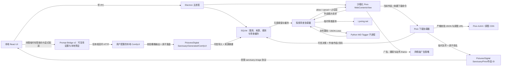

# 纯净领域架构与演进计划

- 文档状态：当前架构基线 + 后续演进计划
- 基线日期：2026-08-24
- 最近同步：本地元素透视已拆成识别说明、本图提示词整理与探索拦截三块；Prompt Bridge v2 只持久化可复用设置，本图标签取向不再跨作品累积；显式启用的本机 ComfyUI 桥接继续负责生成任务、结果回收和来源追溯
- 面向读者：接手实现的开发者或代码模型

## 1. 产品边界

纯净领域是本地优先的 Pixiv 安全浏览与二次元图片管理桌面应用。它过滤的是用户明确不欢迎的**画面元素**，不是年龄分级。

必须保持的产品语义：

- 正常 R18、裸体、色情或擦边内容不是默认拦截目标。
- 猎奇、血腥、断肢和当前模型可覆盖的排泄相关元素才进入黑名单规则。
- 未检查完成的远程图片仍保持保护态，但“模型故障”和“真实命中规则”必须是两种不同状态。模型整体不可用时暂停受保护探索并显示一个总故障页，不生成逐图拦截结论。
- 广告过滤与内容过滤是两条独立管线：广告看页面/网络语义，内容过滤看图片本身。
- 个人偏好只来自用户明确点击并确认的标签；一次反馈不足以形成全局拦截，收藏、下载和画廊浏览都不是隐式训练信号。
- 失败闭合只约束远程探索展示和明确要求模型分析的任务；所有已经进入本地画廊的资产都属于可信输入，卡片、相册、画师页、水族馆和大图查看器始终正常显示。模型结果只用于用户主动发起的分类、检索和建议。
- 不在 Electron 内嵌页运行第三方 OAuth，不伪装浏览器指纹，不读取账号凭据或复制系统浏览器 Cookie。

## 2. 当前运行架构



### 2.1 前端 UI
- 基于 React 19，不依赖厚重 UI 库；建立统一的 **Design Tokens 系统**（基于 CSS 变量的蔚蓝主题色盘、多层级精密阴影、亚克力毛玻璃光影与系统字体中英文排版规范）。
- 渲染样式以 `styles.css` 作为只含有序 `@import` 的清单，实际规则位于 `renderer/src/styles/` 的 21 个职责模块中；`electron.vite.config.ts` 会在内存中按清单合成单一虚拟 CSS 模块，以兼顾源码边界、原有级联语义和大图库滚动性能。新增页面样式不得重新堆回清单文件，也不得绕过虚拟入口逐个导入。
- 渲染层按应用壳、画廊、探索、设置、作者、分类和原图查看器拆分。按钮、分段菜单、通知与对话框使用共享组件；对话框统一提供焦点约束、滚动锁定、`Esc` 关闭和忙碌保护。
- **画廊与卡片沉浸感**：顶部采用影院级 Ambient Hero 动态氛围横幅；作品卡片支持多页作品相纸堆叠（Stack Effect）视觉与悬浮升降微交互。
- **影院级大图全貌沉浸查看器（Cinema Lightbox）**：全景纯净舞台居中完整展示原图（Zero Crop / Full Aspect-Ratio）；支持鼠标滚轮无级缩放（`0.5x` ~ `5.0x`）、拖拽平移（Pan）、双击极速自适应/1:1 回弹切换；浮动毛玻璃控制胶囊在静止时自动隐匿；底部为多页作品提供半透明缩略图胶片轨道。
- **画集相册（Albums & Artbooks）全景双页对开画廊体系**：将分类相册全面升维为实体艺术画集体验；详情页采用精装对开展台（Spread-based Layout），第 1 展对为卷首题记与封面首作，后续内页左页与右页全部对开展出独立装裱画作；支持两组相互独立的持久偏好——4 种实体装裱风格（典藏相角、和纸手账、画廊浮雕、复古拍立得）与 4 种翻页效果（3D 典藏翻页、平移动画、柔光渐隐、层叠抽拉）；支持通过顶部胶囊与全局键盘快捷键 `T` / `M` 随时唤起【浮动亚克力毛玻璃篇目索引抽屉（Floating TOC Drawer）】进行模糊搜索与原子展对直达。
- **画册 3D 动力学引擎与单一原子状态机（Unified Atomic Spread State Machine）**：采用 0.64s 典藏空气动力学贝塞尔曲线与 2.4px 物理厚度微层，将当前展对与翻页转场收敛至不可分割的单一原子状态机，配合全集原画 GPU 显存级同步预解码（`decoding="sync"`）与预缓存，彻底根除时序穿透、图层复位跳跃与布局空白刷新闪烁。
- **字体排印与自定义字体系统（Typography & Custom Fonts Ecosystem）**：定义 4 大语义化字体槽位（界面无衬线、标题典藏衬线、代码等宽、画册手写体）；主进程内建零依赖 SFNT（TrueType/OpenType）二进制安全解析器与 SHA-256 指纹校验，支持字体文件拖拽/选择导入至 `userData/fonts/` 沙箱，通过受限 `sanctuary-font://` 协议与动态 `@font-face` 实现零重启热注入与个性化排版定制。
- **分类组合与组合视图（Saved Collection Views）**：相册页支持将多个普通相册组合为保存视图；支持多选包含/排除、实时防抖匹配数量与封面预览、拼贴卡片及画廊顶部组合条件摘要栏。
- **探索防线雷达 HUD**：同时显示模型启动中、保护就绪、模型故障和本次无保护浏览；只有完整模型结果命中用户规则才累计“拦截”。
- **元素透视与提示词整理**：本地画廊大图的“元素透视”入口复用当前单页 WD 标签，并拆为“看懂画面 / 整理提示词 / 设置探索拦截”。标签百分比只表示模型识别把握，不转换为生成权重；正向 / 忽略 / 负向是当前作品当前页的临时选择，切换作品、页或模型后重置。Danbooru、SDXL 插画与 FLUX 自然语言转换、原始/正向/负向预览、系统剪贴板复制、个人负向词库和主动保存的预设继续可用；只有格式、负向词库和预设按视觉引擎与版本持久化。
- **ComfyUI 本地桥接**：设置页显式启停、测试回环地址、导入/删除 API Format 工作流；调音台只允许从数据库已索引且存在的本地页显式发起。任务状态持久化，所有返回栅格图经 MIME、体积、文件签名和安全路径校验后原子保存并作为可信资源加入画廊；生成作品的大图可查看来源作品、正负提示词与工作流摘要。
- **三档性能与显示策略**：持久化精致（Quality）、均衡（Balanced）、省电（Efficient）三档，支持 reduced motion 优雅退化；大图库渐进分页与 `content-visibility` 跳过屏幕外绘制，当前 10,000 作品基准首屏约 564 ms、JS 堆约 22 MB。
- **动态主题引擎与个性化外观系统（全栈完成）**：前端视觉 tokens 与个性化样式解耦为标准化主题包（`theme.json` + `theme.css`）。主进程支持内置/用户主题扫描、文件夹与受限 ZIP 原子安装、活跃主题持久化、安全 CSS 读取、删除回退，以及带本地缓存和限流熔断的 GitHub Contents API 商店；渲染层实现 `<style id="ds-dynamic-theme">` 零刷新无缝热注入；开箱提供 4 套官方深度定制预设（庇护所标准蔚蓝、绝区零 Hollow Zero 潮酷暗调、樱落梦境 Sakura Dream 二次元粉彩、赛博终端 Cyber Deck 霓虹矩阵）；支持用户在设置中心自定义上传个人头像并同步展示于侧边栏品牌区。
- **360° 交互式动力学星盘罗盘（Interactive Compass Dial）**：内嵌于画廊顶部 Ambient Hero 氛围横幅中；采用三角函数极坐标（`Math.atan2`）捕获鼠标转圈拖拽手势，驱动多层差速齿轮（Parallax Differential Rings）、发光磁性指针、12点钟基准对齐指示箭头与物理惯性阻尼衰减（Momentum Damping），实现充满游戏生命力的 360° 无级旋转拨盘换肤互动。

### 2.2 Electron 主进程

- `apps/desktop/src/main/index.ts`：当前仍是组合根，负责窗口、IPC、Pixiv 视图、网络拦截、远程图片审查、下载协调和视觉进程生命周期。
- 主进程启动时申请 Electron 单实例锁；重复启动只唤醒现有窗口，不创建第二个 Pixiv session/view。
- `apps/desktop/src/main/explore-policy.ts`：可单元测试的 URL、权限、广告和资源策略。
- `apps/desktop/src/main/pixiv-dom-adapter.ts`：幂等注入拦截占位层、“仅本次查看”和作品页下载按钮。宽泛的第一方 PR/BOOTH DOM 猜测已经移除，避免再次误伤普通作品。
- `apps/desktop/src/main/thumbnail-service.ts`：独立的版本化缩略图批处理器。每次只串行处理小批资产，缓存命中直接回填路径；缓存文件缺失时自动重新排队。
- `apps/desktop/src/main/saved-collection-view-ipc.ts`：分类组合 CRUD 的运行时校验与 IPC 边界，限制名称、条件数量、ID 长度及包含/排除冲突。
- `apps/desktop/src/main/theme/`：主题清单/商店协议校验、CSS 与路径安全边界、ZIP 解包、原子安装管理、GitHub 商店缓存代理和主题 IPC；服务在首次主题请求时才扫描目录，不阻塞首屏窗口创建。
- `apps/desktop/src/shared/pixiv-download.ts`：Pixiv 页面上下文、AJAX 响应和原图 URL 的纯函数校验。
- `apps/desktop/src/shared/bounded-concurrency.ts`：下载任务使用的通用并发门。收藏作品按顺序处理，单作品内部原图最多四路；Pixiv JSON API 全局间隔至少 800 ms。
- **有界重试**：429、网络异常和 5xx 最多重试两次，单次等待不超过 30 秒；仍失败时抛出批次级错误并停止，不把同一全局故障记成数百个作品失败。
- **连续失败熔断**：下架或无权限作品可以单项跳过，但连续 5 项失败自动停止。403 不再盲目等待 15 分钟。
- **结果语义**：零失败才显示“下载完成”；有成功也有失败时显示“部分完成”，作品进度按“已处理 = 成功 + 失败”计算。
- `apps/desktop/src/main/explore-review-queue.ts` 与 `apps/desktop/src/preload/explore.ts`：生产使用的视口优先审查。document-start 保护样式阻止未知图片闪现，只有接近视口的作品进入有界队列；结果分为 `allowed / blocked / unavailable`。
- `apps/desktop/src/main/explore-preference-calibration.ts`：承载双向显式校准。误拦截会记录具体 Pixiv 页放行例外并小幅上调真实命中标签阈值；“少看类似”会记录具体页隐藏例外，并按用户确认的 WD 标签渐进累积模型版本隔离的个人权重。两种事件都保存旧值、新值与证据次数，支持即时撤销。
- `apps/desktop/src/main/vision-client.ts`：版本化 JSON Lines 客户端、启动就绪握手、模型身份校验、真实小图推理、超时和子进程错误状态机。
- `apps/desktop/src/main/prompt-bridge-ipc.ts`：Prompt Bridge v2 可复用设置的模型版本隔离持久化与系统剪贴板窄 IPC；读取旧 v1 时只迁移格式、负向词库和预设，丢弃旧的跨作品标签取向。
- `apps/desktop/src/main/comfyui/`：本机回环 URL 校验、API 工作流结构/危险路径校验、受限 HTTP 客户端、串行持久任务、输出回收和 IPC。模板可用 `{{positive_prompt}}` / `{{negative_prompt}}` / `{{source_image}}` 显式绑定，也会窄范围识别标准 `CLIPTextEncode` 与 `LoadImage` 节点。
- Pixiv 使用 `persist:pixiv` 独立持久化 session；本地 React 渲染器不能访问其 DOM 或 Cookie。画师馆藏的 Pixiv 深链接只提交受限数字画师 ID，由主进程拼出官方用户页并在应用内探索视图加载；单实例锁避免多个进程造成“登录一次却看似丢失会话”的错觉。

### 2.3 视觉与领域层

- `services/vision/python/`：WD SwinV2 Tagger v3 推理实现。
- `packages/domain/`：元素组、阈值、标签映射、SavedCollectionView、`allow / blur / hide` 决策，以及 Prompt Bridge / ComfyUI 的领域契约与确定性提示词转换。
- `packages/protocol/`：桌面端与视觉子进程之间的协议。
- `packages/database/`：本地图库、自定义画廊分类（含封面绑定）、分类组合视图、独立画师表（含头像快照）、Pixiv 作品来源、元素规则设置和远程审查缓存；Migration 5 新增 `comfyui_jobs` 与 `generation_provenance`，分别保存生成任务状态和结果来源。组合视图的 schema、CRUD、唯一名称约束和损坏 JSON 降级集中在 `saved-collection-view-store.ts`。
- 开发环境检测到 `.venv-gpu` 时优先请求 CUDA，初始化失败回退 CPU。RTX 4050 基准中单图中位数约由 463 ms 降至 72 ms；provider 选择不改变模型版本和缓存语义。

## 3. 当前探索请求流

1. Pixiv 请求普通界面图片、头像或登录素材：直接放行。
2. 请求命中广告/追踪域名：网络层取消，并增加“广告拦截”计数。
3. 请求是非 Pixiv 第三方 iframe：默认取消；`accounts.pixiv.net` 登录页所需的 reCAPTCHA 是窄例外。
4. 请求是视频：当前失败闭合并取消。
5. 请求是 `i.pximg.net` 的 `img-master`、`img-original` 或 `custom-thumb` 作品图：
   - 相同 URL 在进程内去重；
   - 先按规范化 URL、引擎、引擎版本和规则指纹查询持久化缓存；
   - 缓存命中完整结果时直接决定 allow/block，不下载或重复推理；用户明确标记的具体作品页放行/隐藏例外优先处理；
   - 带 Pixiv `Referer` 下载不超过 12 MiB 的临时副本；
   - 只有接近视口的作品才进入串行 WD Tagger 队列，避免屏幕外图片占用算力；
   - 先使用数据库中的当前元素规则判定；硬规则未命中时，再计算个人标签画像的组合分。个人画像至少需要重复证据，一次“少看类似”不会全局隐藏其他作品；
   - `allow` 正常显示；完整结果命中规则才产生 `blocked` 遮罩；单张下载或推理错误返回 `unavailable`，不得显示成“已拦截”；
   - 遮罩提供“仅本次查看”和“这张不该隐藏”。后者永久记录具体页例外，同时透明展示对应标签阈值或个人权重的旧值、新值，并可撤销；
   - 已放行作品悬浮时提供“少看类似”。远程页面只能选择主进程从该图已保存 assessment 中给出的最多 16 个候选标签，最多确认 5 个；通用构图/人物数量标签不会默认勾选。用户也可以只隐藏当前页而不学习标签；
   - 推理后删除临时文件。

当前未命中缓存时仍会为审查下载一次图片、放行后由页面再下载一次。它是安全的最小闭环，但不是最终的网络效率形态。

### 3.1 当前 Pixiv 下载与画廊流

1. 只有作品详情页允许“保存当前作品”；只有收藏作品页允许“下载全部收藏”。网页内按钮携带的作品 ID 必须与当前顶层 URL 一致。
2. 主进程通过登录 session 获取作品页清单、作者信息和公开/非公开收藏 ID；所有 JSON 响应和 `i.pximg.net` 原图 URL 都经过严格校验。
3. 原图请求绕开探索页内容拦截器，使用 Pixiv 作品页 `Referer`、流式临时文件和原子改名；全局网络并发上限为 4。
4. 文件保存在用户“图片/Digital Sanctuary/Pixiv/作品 ID”中；已索引页码连续、文件存在且作者资料已经入库的作品触发本地快速跳过。所有 Pixiv JSON API 请求接入 800 ms 全局节流。
5. 所有用户主动下载都调用 `trustArtwork`：清除旧模型结果并保存明确的 `allow` 决策，不自动运行 WD Tagger。
6. SQLite 保存 `workId`、`pageIndex`、`authorId`、`authorName` 和标题；分离画师实体独立入库。头像不再猜测作品 JSON，而是从 `/ajax/user/:authorId?full=1` 的 `imageBig` 获取并保存本地快照；画廊也提供不重下作品的显式补全入口。
7. 本地图片仅通过 `sanctuary-image` 自定义协议返回，并且只有数据库已索引、文件仍存在的路径可以读取。
8. 画廊提供基于分类组合（Saved Views）的虚拟布尔筛选（AND / OR / NOT），支持多分类复合查询，不复制或修改底层作品文件与分类实体。

## 4. 安全不变量

- `contextIsolation: true`、`nodeIntegration: false`、`sandbox: true`、`webSecurity: true`。
- 顶层导航只允许 HTTPS `pixiv.net` 及子域。
- 弹窗、下载和权限默认拒绝；例外必须是可测试的窄规则。
- 远程 Pixiv 页面不获得本地文件、数据库、视觉进程或通用 IPC 权限。
- “少看类似”的标签、置信度和旧画像都由主进程从当前模型版本的已保存 assessment 重新核验；远程页面不能提交任意标签或直接设置权重。
- 系统浏览器入口只能打开代码中固定的 Pixiv 官方密码设置 URL。
- 过滤规则变化后必须使旧的远程审查缓存失效。
- 任何缓存键必须包含模型/引擎版本和规则指纹；规则指纹同时覆盖硬规则、适应阈值与个人画像摘要，不能把旧模型或旧画像的 `allow` 永久复用。
- 被拦截图片在完成判断前必须保持保护态；一次性查看不能改变持久规则。“这张不该隐藏”是独立的明确学习操作，必须保存具体页例外、显示阈值变化并允许撤销。
- 视觉进程只有在模型装载握手和启动推理都成功后才可以标记 ready。模型故障必须暂停受保护探索；用户只有显式选择后才能进入当前会话的无保护浏览。
- 远程 Pixiv 页面不能直接指定下载目标路径；所有作品 ID、原图域名、扩展名、文件上限和落盘目录由主进程重新验证或生成。
- ComfyUI 只接受 `http://localhost`、`127.0.0.0/8` 或 `[::1]` 回环根地址，禁止账号、远程主机、额外路径、查询和片段；桥接默认关闭，只有用户显式开启后才允许入队。
- ComfyUI 工作流限制为 2 MiB / 1,000 节点，拒绝本机绝对路径、上级目录跳转、危险键名与无正向提示词绑定；无需参考图的模板不会上传图片。返回 JSON、图片数量、图片体积、MIME 与文件签名都有上限。
- “用户信任”和“模型分析”是不同概念。未来的图库整理模型只能写标签或建议，未经用户确认不能把主动下载作品改为模糊/隐藏。

## 5. 广告过滤分层

广告过滤不能与元素黑名单混为一谈：

1. **网络级过滤（已实现并保留）**：拦截已知广告/追踪域名和站外 iframe，降低请求数与渲染进程数。
2. **Pixiv 第一方美容过滤（冻结）**：旧的 DOM 祖先猜测曾引发 KI-0003，把普通作品列表整块隐藏，现已移除。第一方 PR/BOOTH 卡片可能继续出现，当前优先使用 Pixiv Premium 官方广告开关；若以后恢复，必须采用标准规则引擎或有夹具覆盖的精确适配器。

第一方广告与普通作品共用 Pixiv 域名和图片 CDN，不能封禁整个 `pixiv.net`/`pximg.net`，也不能把广告插画当作不欢迎元素送入 WD Tagger。

## 6. 主进程模块边界

发布收尾已经抽出并测试以下稳定边界：

- `window-state.ts`：多显示器窗口状态校验与安全收敛；
- `library-ipc.ts`：作品查询、详情读取和缩略图批任务 IPC；
- `saved-collection-view-ipc.ts` / `packages/database/src/saved-collection-view-store.ts`：分类组合输入校验、IPC 注册与 SQLite 持久化；
- `analysis-ipc.ts` / `analysis-job-runner.ts`：显式分析 API 与严格串行、可取消的执行器；
- `model-center/catalog.ts` / `model-center/model-center-service.ts`：受信任模型清单、断点下载、文件大小与 SHA256 校验、受控安装目录、能力分组和当前模型切换；
- `explore-policy.ts`、`explore-review-queue.ts`、`pixiv-dom-adapter.ts`：导航/广告策略、审查队列和远程 DOM 适配；
- `shared/pixiv-download.ts` / `shared/bounded-concurrency.ts`：Pixiv 响应解析、下载状态和并发原语；
- `thumbnail-service.ts`、`vision-client.ts`：缩略图缓存和模型子进程协议。

`index.ts` 仍负责 Electron 生命周期和需要共享 Pixiv session 的下载/探索协调。继续迁移时沿用下面的控制器目标，不在发布收尾阶段重写已经通过回归的远程请求链路。

在继续扩大功能前，将 `apps/desktop/src/main/index.ts` 中的探索逻辑逐步迁移为：

```text
apps/desktop/src/main/explore/
  controller.ts              # WebContentsView 生命周期与状态汇总
  navigation-policy.ts       # 顶层导航、弹窗、权限和下载
  adblock-policy.ts          # 广告域名和站外 iframe 策略
  pixiv-url-adapter.ts       # 作品 CDN URL 识别与规范化
  pixiv-dom-adapter.ts       # 第一方 PR 卡片、占位层和页面结构探针
  review-coordinator.ts      # 去重、排队、下载、判定和统计
  review-cache.ts            # SQLite 持久化审查缓存
  types.ts                   # ExploreState 等共享主进程类型

apps/desktop/src/main/download/
  controller.ts              # 单作品与收藏任务、进度和取消边界
  pixiv-api.ts               # 登录 session 下的 Pixiv AJAX 访问
  original-fetch.ts          # 原图流式下载、限流、临时文件与原子改名

apps/desktop/src/main/library/
  controller.ts              # 导入、可信下载入库与显式模型整理入口
```

迁移必须小步进行：先复制测试覆盖，再移动代码，不要一次性重写 `index.ts`。

## 7. 持久化审查缓存计划

SQLite 已增加并使用 `remote_image_reviews`：

```sql
CREATE TABLE remote_image_reviews (
  normalized_url TEXT NOT NULL,
  content_hash TEXT,
  engine TEXT NOT NULL,
  engine_version TEXT NOT NULL,
  rules_fingerprint TEXT NOT NULL,
  assessment_json TEXT NOT NULL,
  decision_json TEXT NOT NULL,
  byte_length INTEGER NOT NULL,
  reviewed_at TEXT NOT NULL,
  PRIMARY KEY (normalized_url, engine, engine_version, rules_fingerprint)
);
```

实施要求：

- 只缓存完整、可解析的审查结果；网络错误和模型错误不应成为永久记录。
- 规则指纹由启用状态、标签、阈值和动作的稳定序列计算。
- 非空个人画像的标签、权重、证据次数与启用状态追加到规则指纹；空画像保留原指纹，避免无意义地废弃历史缓存。
- 模型或标签表版本变化时不能复用旧结果。
- 设定容量/时间清理策略；不要永久保存远程图片文件。
- 若未来用内容哈希跨 URL 复用，仍要验证响应内容，不能只相信 URL 参数。
- 当前默认在应用启动时清理超过 30 天或超出 2,000 条的记录；只保存 `status=complete` 结果。

## 8. 显式模型整理边界

模型整理使用 `analysis_jobs`、`analysis_job_items` 和 `analysis_asset_results`，不复用旧 `artworks.assessment_json` 作为画廊展示信任：

- 只有用户预览范围并点击开始后，任务才进入串行模型队列；启动、滚动和下载不会触发任务。
- 范围保存为不可变的作用域快照；任务项落实到当时可用的本地图片资产。
- 资产更新时间与引擎一致时可以复用完整分析；文件或引擎变化后必须重新推理。
- 取消在当前单张推理结束后生效；异常退出会把 `running` 任务标为失败，不自动恢复运行。
- 标签建议与探索拦截、主动下载信任完全分离；只有用户勾选并确认的建议才创建分类关系。
- 本地画廊展示层不读取 `allow / blur / hide` 来决定可见性；既有旧决策可以作为分析记录保留，但不能再生成视觉遮罩。

### 8.1 标签语义与本地生成边界

- Prompt Bridge 与探索个人偏好只共享 WD 标签名称，不共享用户动作：探索偏好决定远程遮罩；本图正向 / 忽略 / 负向只决定当次导出文本；任何一方都不能改变本地画廊可信显示。
- 本图标签取向不持久化，切换 `workId + pageIndex` 或模型后按识别把握重新建立默认值。`engine + engineVersion` 只隔离输出格式、个人负向词库和主动保存的预设；所有转换是可测试的确定性规则，不暗中调用在线模型。
- 标签百分比只负责候选筛选与排序，不生成 `(tag:weight)` 权重。真正的生成权重应由用户在后续生成工具中明确决定，不能拿分类模型置信度冒充。
- ComfyUI 任务必须引用现存 `workId + pageIndex + templateId`，主进程重新解析本地资产路径，Renderer 不能提交任意文件路径或任意落盘目录。
- 生成任务严格串行；异常退出把旧 `running` 任务标为失败，不自动重跑。取消只停止本地等待并明确提示 ComfyUI 端可能仍在执行。
- 每个返回输出建立独立可信画廊作品和 `generation_provenance`；来源删除时相应来源记录级联清理，但不会让探索规则反向作用于生成资源。
- 区域级遮罩未接入生产。当前 WD Tagger 没有坐标，准确率、显存与延迟门槛见 `docs/research/REGION_LEVEL_MASKING_GATE_2026-08-24.md`。

### 8.2 模型中心与视觉雷达运行边界

- 安装包继续只携带日常所需的 WD SwinV2 基础模型；模型中心不会在首次启动时静默下载数 GB 权重。其他模型必须由用户明确点击安装。
- 可下载模型来自代码内受控清单，下载地址必须是 HTTPS，文件名、声明大小和 SHA256 都通过后才能从暂存目录进入正式模型目录。中断保留 `.part` 文件供续传；不能把任意 URL 或任意磁盘路径交给 Renderer。
- `element_tagging` 模型切换会重启同一个视觉客户端并执行 ready 握手与启动探针。新模型启动失败时尝试恢复原模型；已保存选择丢失或文件不完整时自动回退内置模型。
- 画廊大图的“本地技术画像”是用户主动触发的确定性图像统计，只保存到 `vision_evaluation_results`，不影响画廊显示、探索规则或个人偏好。
- Python 视觉子进程与 Electron 之间的 JSONL 标准输入输出固定为 UTF-8，不继承 Windows 控制台代码页；固定套件维度名在 IPC 校验和数据库读写时都由领域注册表规范化，因此旧缓存中的乱码标签也会在读取时恢复。
- “AI 美术六维”可使用已启用的外部视觉服务，也可使用模型中心显式安装并启用的本地 Qwen3-VL / Gemma 4 评论模型；Gemma 4 E2B Q4 为流畅档，E4B Q4 为高质量推荐档，均不随安装包静默下载或自动替换当前选择。结果永久记录 provider、model、套件、提示词与预处理指纹，失败结果不进入长期缓存。
- 本地评论模型由独立 llama.cpp 回环子进程承载，只监听随机 `127.0.0.1` 端口并使用随机 API Key；启用先做健康自检、推理严格串行、闲置 2 分钟或显式停用后退出。其故障域与探索 WD Tagger 完全隔离。
- 外部模型仓库名不是模型身份。可下载评论模型的 URL 必须锁定完整仓库提交号，不使用可漂移的 `main`；文件名、精确字节数和 SHA256 同时匹配后才能安装。仓库改名只影响远程解析，已安装的本地目录继续按内部 model ID 与版本运行。
- 固定六维套件适合相对比较；`external_adaptive_highlights` 允许模型按单张作品自行命名恰好六个轴。模型误把中文显示名写入内部 key 时，适配层会生成稳定的安全 key；多返回 1 至数项时按模型分数保留最高六项。修复后仍须通过唯一标签、具体理由、有效分数、非全零和严格 JSON 门禁，少于六项时不凭空补造，也不能假装成可跨作品统一排序的客观尺度。
- 轻量美感分类头仍只进入受信任目录展示并标记“运行时待接入”；在其特征提取器和标签语义完成验证前不得伪装成可安装或可启用。
- 详细能力矩阵、落盘规则和后续门槛见 `docs/design/MODEL_CENTER_AND_RADAR_RUNTIME.md`。

## 9. 近期架构里程碑

1. **已完成**：元素黑名单、远程失败闭合、持久化审查缓存、占位层和一次性查看。
2. **已完成**：作品全部页保存、公开/非公开收藏批量下载、四路限流、原子落盘、去重与来源元数据。
3. **已完成**：主动下载信任边界、原图懒加载、平铺/作者两级浏览和沉浸式大图层。
4. **已完成**：MVP 画廊资产管理重构，引入独立 `ArtistRecord`（本地头像）并扩展 `CollectionRecord`（自定义封面与分类详情浏览）。
5. **部分冻结**：第一方广告美容过滤及宽泛 DOM 方案不得恢复；视口审查已在状态分离、故障门和回归测试补齐后重新启用，仍需真实站长滚动验收。
6. **已完成**：作品级数据迁移、数据库查询/分页、安全删除、共享交互组件以及画廊/探索/设置组件边界。
7. **已完成**：版本化缩略图、自动分页和屏幕外绘制跳过已经接入；真实 Electron 10,000 作品基准覆盖首屏、连续触底、内存门槛和图片元素计数。
8. **已完成**：模型整理采用显式范围预览、持久任务、取消、缓存和二次确认的分类建议流程；分析结果与展示信任状态分表保存。
9. **已完成**：UI/UX 现代化二次元极简设计系统重构；引入 Design Tokens、影院级 Ambient Hero、多页作品相纸堆叠视觉、大图悬浮控制台与探索防线雷达 HUD。
10. **已完成**：主进程模块化拆分、一致性备份与 Windows 打包验收。
11. **已完成**：分类组合与组合视图（Saved Collection Views）；支持多分类交集（AND）、并集（OR）、排除（NOT）复杂查询与实时防抖预览，数据库迁移至版本 3。
12. **已完成**：动态主题生态与 360° 动力学星盘罗盘；支持标准化主题包安装、GitHub 商店与物理惯性拨盘换肤。
13. **已完成**：字体排印与本地自定义字体系统（Typography）；4 大语义化槽位、SFNT 安全二进制解析器、`userData/fonts/` 沙箱、`sanctuary-font://` 协议与动态热注入。
14. **已完成**：实体级全景双页对开画册（Double-Spread Photobook）与 3D 动力学原子状态机；4 种装裱风格、浮动毛玻璃目录抽屉、GPU 预解码与零时序穿透 3D 翻页。
15. **已完成并实机验收**：画廊可信显示、模型 ready 握手与启动推理、探索全局故障门、视口审查重新启用，以及“这张不该隐藏”的具体页例外、按标签渐进校准和即时撤销。
16. **已完成并实机验收**：探索双向个人偏好学习；包含“少看类似”候选标签层、具体页隐藏、重复证据门槛、个人组合分、模型版本隔离画像、透明数值反馈、撤销及设置页启停/重置。本地画廊继续完全不读取该画像。
17. **已完成并实机验收**：元素透视三页工作区与 ComfyUI 本地桥接；包含识别把握说明、本图临时三态、模型适配提示词、复制/负向词库/预设、本机连接与工作流模板、持久生成任务、多输出回收、可信入库和来源查看。区域级遮罩独立评审未过门，保持不实现。
18. **已完成第二阶段并通过本地实机烟雾测试**：模型中心、受控下载校验与安全运行时展开、WD 系列模型热切换与失败回退、本地技术画像、外部固定六维，以及 Qwen3-VL 本地标准/自选六维评论、结构化结果拒绝门禁和闲置资源释放。轻量美感分类头继续保持未接入。

详细任务与止损条件见 `docs/plans/ACTIVE_ROADMAP.md`，验收步骤见 `docs/handoff/02_VERIFICATION_CHECKLIST.md`。
