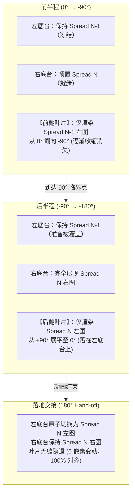

# 《纯净领域》画册翻页视觉闪烁（Flicker）深度技术剖析与终极根治方案

> **文档性质**：图形学渲染管线与 React 状态机深度分析报告  
> **适用对象**：图形学工程师、Chromium 内核开发者、前端架构师、高级 AI 代码模型  
> **基准代码**：`apps/desktop/src/renderer/src/CollectionGallery.tsx` & `collections.css`

---

## 1. 现象复现与逐帧诊断 (Frame-by-Frame Trace)

通过对用户录制的 `录制_2026_08_15_17_28_15_736.mp4` 进行 30fps 逐帧拆解（见下表），闪烁在翻页全周期中由 **3 个独立的物理渲染阶段** 共同引发：

| 时间戳 | 对应关键帧 | 屏幕实际渲染状态 | 预期渲染状态 | 异常现象 |
| :--- | :--- | :--- | :--- | :--- |
| **0.00s** | `f_0000` | 左：展对 0 左页（题记） 右：展对 0 右页（白发猫娘） | 展对 0 静态展示 | 正常静态展示 |
| **2.80s** | `f_0084` | 点击“下一页”，底台右页瞬间变为海滩少女（展对 1 右页） | 展对 0 右页被叶片完全覆盖 | **【闪烁 1 · 起步时序穿透】**：3D 叶片类名激活到 GPU 纹理栅格化存在 1 帧（16ms）延迟，导致底层的新画作提前暴露，人眼看到原图闪了一下新图。 |
| **3.00s~3.40s** | `f_0090~f_0102` | 3D 双面叶片由 0° 翻向 -180°，背面为粉发猫娘（展对 1 左页） | 0°~-180° 3D 旋转 | 运行中伴随 `backface-visibility` 在 90° 附近的浮点裁切撕裂。 |
| **3.50s** | `f_0105` | 3D 叶片动画结束被 unmount；**左页底台瞬间闪退回了展对 0（题记）！** | 左页底台应呈现粉发猫娘 | **【闪烁 2 · 状态延迟回退】**：叶片卸载瞬间，左侧底台因状态更新未原子对齐，暴露了旧展对 0 的内容，造成剧烈白闪与画面回退！ |
| **3.60s** | `f_0108` | 左页底台延迟更新为粉发猫娘（展对 1 左页） | 展对 1 静态展示 | 画面再次突变，与 3.50s 的题记形成二次闪跳。 |

---

## 2. 四大深层技术根因剖析 (Root Cause Analysis)

### 根因 1：Chromium DirectComposition 3D 双面背向裁切缺陷 (`backface-visibility: hidden` Sub-pixel Bleed)
- **底层原理**：在 Chromium（Windows D3D11 / ANGLE 后端）中，当在同一个 `transform-style: preserve-3d` 容器中放置两个分别旋转 0° 与 180° 的背靠背子元素时，GPU Compositor 在计算视锥体面法线点积时，在 $88^\circ \sim 92^\circ$ 临界角附近会产生浮点精度抖动（Z-Fighting）。
- **后果**：即使设置了 `translateZ(1.2px)` 物理间距，背面的图片纹理（特别是包含复杂光影与子像素文本时）仍然会在中途某一帧“穿透”正面，造成翻页过程中的纹理跳跃。

### 根因 2：React 多状态非原子调度导致的时序断层 (Multi-State Desynchronization)
- **底层原理**：之前的架构将当前书页 `spreadIndex` 与翻页动画 `transitionState` 拆分在两个独立的 `useState` 中。
- **后果**：当 CSS `onAnimationEnd` 触发时，`setTransitionState(isAnimating: false)` 使得 3D 动画叶片被立即卸载；但如果 `spreadIndex` 的更新未在同一微任务队列中完全原子提交，渲染引擎就会在 `isAnimating === false` 时读取旧的 `spreadIndex=0`，导致左侧书台在叶片消失的瞬间**裸露并渲染上一页（卷首题记）**，1 帧之后才跳到新图！

### 根因 3：底台与叶片“先换图再遮盖”的层级穿透 (Bottom Layer Pre-swap Glitch)
- **底层原理**：在用户点击“下一页”的同一渲染周期内，底台右页被直接赋值为了目标展对的图片（海滩少女），同时在它上方叠加 3D 叶片（白发猫娘）。
- **后果**：GPU 线程创建 3D 合成层并分配 RenderPass 纹理需要花费微秒级时间，在此期间底台已经完成了 2D 绘制，导致用户在叶片起飞前看到新图“刷新闪现”了一下。

### 根因 4：DOM 节点销毁重建引发的重绘白闪 (Unmount/Mount Layout Pop)
- **底层原理**：如果在页面或图片组件上绑定了随页码变化的 `key`（例如 `key={spreadIndex}`），React 会强制销毁已有 `` 并重建全新 DOM。
- **后果**：即使图片在浏览器缓存中，全新的 `HTMLImageElement` 也会触发初始布局重排（Layout Reflow）与纹理重绑定，视觉上表现为“类似网页 F5 刷新的白块闪烁”。

---

## 3. 终极根治架构方案：双半程单面隔离折叠引擎 (Split-Phase Single-Sided Folding Architecture)

参考行业顶级翻页引擎（**Apple Books / Turn.js / StPageFlip**）的标准实现，彻底废弃不稳定的“3D 双面背靠背叶片”，改为**单面分段物理翻折引擎**：

### 核心设计原则：

1. **绝对单面（Zero Backface Visibility）**：
   - 翻页叶片在任何时刻都只有**单面朝向屏幕**（前半程只有正面，后半程只有背面）；
   - 从物理结构上 100% 消除 `backface-visibility`、Z-Fighting 与双面穿透。
2. **单一原子状态机（Single Atomic State Machine）**：
   - `currentSpread`、`isAnimating`、`direction`、`fromSpread`、`toSpread` 必须在一个不可分割的 State 对象中；
   - 动画完成时单次原子调用更新状态，杜绝任何中间脏帧。
3. **书台 DOM 树绝对常驻（Zero Unmount）**：
   - 底台与图片标签永久驻留，禁用破坏性 `key`；
   - 换页时仅就地更新 `src` 与文本；
   - 全本原画在进入相册时全局执行 `decoding="sync"` 显存预解码，确保切换时 0ms 显存直出。
