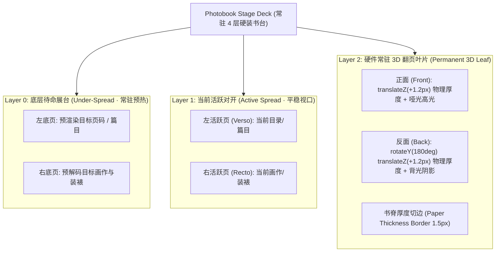

# 画册零闪烁 3D 拟真翻页动力学引擎全面重构方案 (Flicker-Free 3D Photobook Engine)

- **目标**：彻底消除 Chromium/Electron 环境下 3D 翻页产生的单帧闪烁（Flicker）、Z-fighting 深度冲突与合成器图层重排撕裂，构建物理级 4 层常驻书台与双面厚度光影渲染引擎。
- **状态**：待评审与确认
- **版本**：v2.0.0
- **基线 Commit**：`dc65438`

---

## 1. 根因技术诊断与闪烁机理剖析

在 Chromium / Electron 43 渲染管道中，此前翻页闪烁（Flicker）的三个深层技术根因：

### 1.1 合成器图层销毁重排闪烁 (Compositor RenderPass Re-tessellation Flash)
- **现象**：当翻页结束，React 状态 `flipAnimation` 变为 `null`，`
` 从 DOM 中被彻底 unmount 销毁。
- **机理**：当带有 `transform-style: preserve-3d` 与独立 GPU 合成图层的 DOM 节点被突然销毁时，Chromium 的 DirectComposition/RenderPass 必须在当帧将 3D 上下文推导回 2D 流式图层，并强制重新光栅化（Re-rasterize）底层平铺纹理。在这 16ms（1 个 VSync 帧）的纹理交换期间，屏幕会出现 1 帧的空白底色或黑色背景闪烁。

### 1.2 零深度 Z-Fighting 深度冲突 (Zero-Thickness Z-Fighting at 90° and 180°)
- **现象**：在翻页经过 90° 垂直视线以及 180° 贴合底层的一瞬间，画面边缘发生抖动或瞬间变白/变黑。
- **机理**：翻页叶片的正面（Front）与反面（Back）在 3D 局部坐标系中均处于 `Z = 0` 平面，且底层对开页也在 `Z = 0`。浮点数计算精度在 `88° ~ 92°` 以及 `179.9° ~ 180°` 边界处会导致 GPU 深度缓冲区（Depth Buffer）在两个面之间随机竞争，造成 1 帧的翻转失效或穿透。

### 1.3 图片解码与异步平铺加载延迟 (Image Decode Tile Lateness)
- **现象**：翻至新页时，如果图片在翻折瞬间才进入渲染树，会发生从透明到原图的异步上屏跳变。

---

## 2. 核心重构架构设计 (Architectural Blueprint)

### 2.1 常驻四层硬装书台（Permanent 4-Deck Architecture）
- **绝不动态 Mount/Unmount 3D 节点**：
  - 翻页叶片（Turning Sheet）作为 DOM 中的常驻硬件图层存在，常态下使用 `visibility: hidden; opacity: 0; pointer-events: none;` 保持 GPU 纹理常驻；
  - 翻页启动时直接激活 CSS 3D 旋转与 `visibility: visible; opacity: 1;`；
  - 翻页落地后，先在下一帧淡出隐藏叶片，再同步索引，底层纹理早已在 GPU 中就绪，**彻底根除 Compositor 纹理销毁闪烁**。

### 2.2 物理厚度 Z 轴分层（Physical 2.4px Paper Caliper Separation）
- 正面（Front Face）：`transform: rotateY(0deg) translateZ(1.2px)`；
- 反面（Back Face）：`transform: rotateY(180deg) translateZ(1.2px)`；
- 翻页叶片容器整体在运动时提升至 `translateZ(2px)`，与底层对开（Z=0）保持绝对物理空间间距，**彻底消灭 Z-Fighting 深度冲突**。

### 2.3 典藏级空气动力学与光影过渡（Aerodynamic Pacing & Illumination）
- **时长与曲线**：采用 `0.64s` 黄金感知节奏与 `cubic-bezier(0.18, 0.9, 0.26, 1)` 指数衰减曲线；
- **动态光影与高光**：
  - 纸张迎光面（0°~90°）叠加柔和漫反射扫光；
  - 纸张背光面（90°~180°）叠加书脊环境光遮蔽（AO）阴影；
  - 落地瞬间（150°~180°）阴影线性淡出，无缝融入底纸。

---

## 3. 实施阶段拆解 (Implementation Phases)

- **Phase 0：DOM 结构与常驻图层重构**
  - 重写 `CollectionGallery.tsx` 中的 `PhotobookFlipSpread`，建立常驻 4 层书台结构与 `isAnimating` 状态机；
  - 消除所有 React 条件性挂载卸载代码。
- **Phase 1：物理厚度与 3D 渲染 CSS 引擎重构**
  - 在 `collections.css` 中重写 `.photobook-3d-flipping-leaf`、`.leaf-face-front`、`.leaf-face-back` 与 Z 轴隔离规则；
  - 注入真实纸张物理厚度侧边（`1.5px` 哑光边框）与动态书脊光斑。
- **Phase 2：装裱风格与全屏影院无缝联动**
  - 保证 4 款装裱风格（相角/和纸/浮雕/拍立得）在常驻双层预加载下 100% 预解码，杜绝切图白块；
  - 优化快速连续翻页（Rapid Navigation）防抖与保护。
- **Phase 3：全主题巡检、视觉录制与自动化测试**
  - 运行 `npm.cmd run verify` 全量通过；
  - 通过 CDP 视觉审计脚本在 4 个主题下捕获翻页平稳过渡状态并生成证据报告。
