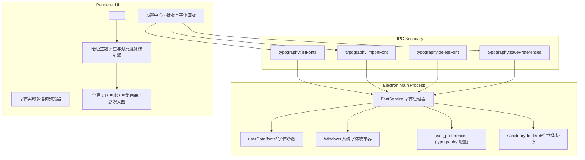

# 纯净领域排版系统升级与自定义字体支持架构计划（Typography System & Custom Fonts）

- **任务代号**：`TASK_TYPOGRAPHY_SYSTEM_AND_CUSTOM_FONTS`
- **计划状态**：已完成需求对齐，待用户批准后实施
- **基线 Commit**：`dedb39b3be5f714a3b67a07a2d729d835c0877b3`
- **核心目标**：
  1. 彻底解决暗色/高饱和/毛玻璃主题下部分字体与字重看不清、边缘发虚的易读性缺陷；
  2. 建立结构化的四层排版 Tokens 规范（UI 正文、艺术标题、画册题记与等宽数据）；
  3. 实现双轨制字体扩展能力：内置开箱即用的高品质开源二次元与人文字体预设，同时支持用户导入本地 `.ttf / .otf / .woff2` 字体文件及拾取 Windows 系统已安装字体。

---

## 1. 核心需求与设计原则

根据 `/grill-me` 深度访谈确认的决策结论：

1. **双轨制字体源**：
   - **预设字族（Built-in Presets）**：系统内置轻量优质的中英文开源字体配置（现代几何无衬线、二次元潮流黑体、人文楷宋古典题记）；
   - **自定义字体导入（Custom Fonts Import）**：支持用户选择本地 `.ttf`、`.otf`、`.woff2` 字体文件，主进程将其安全复制至 `userData/fonts/` 沙箱管理；
   - **系统字体拾取（System Fonts Picker）**：支持枚举并选用当前 Windows 系统中已安装的个性化字体。
2. **分层级独立配置（Layered Typography Slots）**：
   - **UI 正文字体 (`--ds-font-body`)**：面向侧边栏、网格元数据、表单控件与列表，追求极致的清晰度与视认性；
   - **艺术标题字体 (`--ds-font-display`)**：面向页面主标题、Hero 氛围横幅与星盘罗盘；
   - **画册题记字体 (`--ds-font-serif`)**：面向精装画册卷首语、引言诗句与篇目索引；
   - **等宽数据字体 (`--ds-font-mono`)**：面向作品 ID、尺寸分辨率、文件哈希与状态监控。
3. **主题可读性与字重自适应补偿（Theme Readability Engine）**：
   - 在暗色主题（如 Hollow Zero、Cyber Deck）及深色画册舞台下，自动激活字重微调（`font-weight: +50 ~ +80`）与文字抗锯齿补偿（`-webkit-font-smoothing: antialiased`），消除深色背景下白字发虚、细笔画消失的问题；
   - 提供文本微光描边（Text Glow / Subtle Drop Shadow）保底策略，确保复杂背景上依然清晰可辨。
4. **安全沙箱与无缝字形回退链（Fail-Safe Fallback Chain）**：
   - 自定义字体建立严密的回退链：`[User Custom Font] -> [Curated Open-Source Fallback] -> [Segoe UI Variable / PingFang SC] -> [Microsoft YaHei UI] -> sans-serif`；
   - 缺字或加载失败时平滑降级，绝不产生布局坍塌或方块乱码（Tofu）。

---

## 2. 总体技术架构

---

## 3. 分阶段实施路线图

### Phase 0: 基础设施与契约定义
- 在 `packages/domain` 中定义排版与字体类型契约：
  - `TypographyPreferences`: `bodyFont`, `displayFont`, `serifFont`, `monoFont`, `weightCompensation`, `customFonts`；
  - `FontDescriptor`: `id`, `name`, `family`, `source ('preset' | 'system' | 'custom')`, `filePath`, `format`, `previewText`；
- 在 `packages/protocol` 中注册 `typography:*` 窄 IPC 通信通道。

### Phase 1: 主进程字体沙箱与安全协议
- 实现 `apps/desktop/src/main/typography/font-service.ts`：
  - 扫描与管理 `userData/fonts/` 目录中的字体文件；
  - 导入字体：安全重命名、校验扩展名（`.ttf`, `.otf`, `.woff2`）、提取字体元数据（使用轻量 OpenType/TrueType 头部解析器提取 family name）；
  - 枚举 Windows 系统已安装字体（通过 Windows Registry / PowerShell 查询或 Chromium 渲染层通信）；
- 注册 `sanctuary-font://` 安全协议，支持渲染层直接按需加载本地沙箱字体。

### Phase 2: 渲染层动态排版注入与主题字重补偿
- 扩展 `renderer/src/styles/tokens.css`：
  - 引入 `--ds-font-family-body`、`--ds-font-family-display`、`--ds-font-family-serif`、`--ds-font-family-mono`；
  - 引入 `--ds-font-weight-body`、`--ds-text-contrast-filter`；
- 实现 `apps/desktop/src/renderer/src/TypographyProvider.tsx`：
  - 动态在 `<head>` 中维护 `@font-face` 声明与全局 CSS 变量重载；
  - 监听当前主题变化，当切换至深色/高对比主题时自动计算并注入字重补偿系数。

### Phase 3: 设置中心排版管理面板与多语种实时预览
- 在【设置】中增加【排版与个性化字体】专区：
  - 四大槽位独立下拉配置（正文字体、标题字体、画册题记、等宽字体）；
  - 本地字体文件拖拽/点击上传与一键删除；
  - Windows 系统字体智能搜索与选择器；
  - 实时预览卡片（展示中日韩二次元常用字符、英文排版、数字与标点符号效果）；
  - “暗色主题字重自动补偿”与“文字清晰度增强”开关。

### Phase 4: 全产品排版审计与回归验证
- 更新 CDP 巡检脚本 `scripts/visual-audit.mjs`，增加字体切换场景；
- 测试 4 套内置主题下的不同字体渲染效果，确保无锯齿、无重叠、无溢出、无乱码；
- 运行 `npm.cmd run verify` 确保全量测试通过。

---

## 4. 关键代码变更范围

1. **Domain & Protocol**:
   - `packages/domain/src/index.ts`（新增 Typography 类型）
   - `packages/protocol/src/index.ts`（新增 IPC 消息）
2. **Electron Main**:
   - `apps/desktop/src/main/typography/font-service.ts` [NEW]
   - `apps/desktop/src/main/typography/font-ipc.ts` [NEW]
   - `apps/desktop/src/main/index.ts`（挂载 font 服务与协议）
3. **Renderer**:
   - `apps/desktop/src/renderer/src/styles/tokens.css`（定义排版 tokens）
   - `apps/desktop/src/renderer/src/styles/typography-settings.css` [NEW]
   - `apps/desktop/src/renderer/src/TypographySettingsSection.tsx` [NEW]
   - `apps/desktop/src/renderer/src/SettingsView.tsx`（集成排版设置）
   - `apps/desktop/src/renderer/src/App.tsx`（挂载排版上下文）

---

## 5. 验证与验收标准

1. **功能验收**：
   - 设置中可自由切换正文、标题、画册与等宽字体并实时生效（零页面刷新）；
   - 导入本地 `.ttf / .woff2` 字体后可正常使用并持久化；
   - 即使字体文件被删除或格式损坏，也能秒级回退至系统备用字体，无白屏或崩溃。
2. **视觉验收**：
   - 在深色主题（Hollow Zero、Cyber Deck）和画册暗色全屏下，文字边缘锐利清晰，无发虚或低对比度现象；
   - 罗盘、相册书脊、画廊卡片与大图查看器在各类字体下均保持对齐，无文本溢出或高度塌陷。
3. **自动化验证**：
   - Vitest 单元测试覆盖字体服务、协议解析与回退链；
   - `npm.cmd run verify` 100% 通过。
